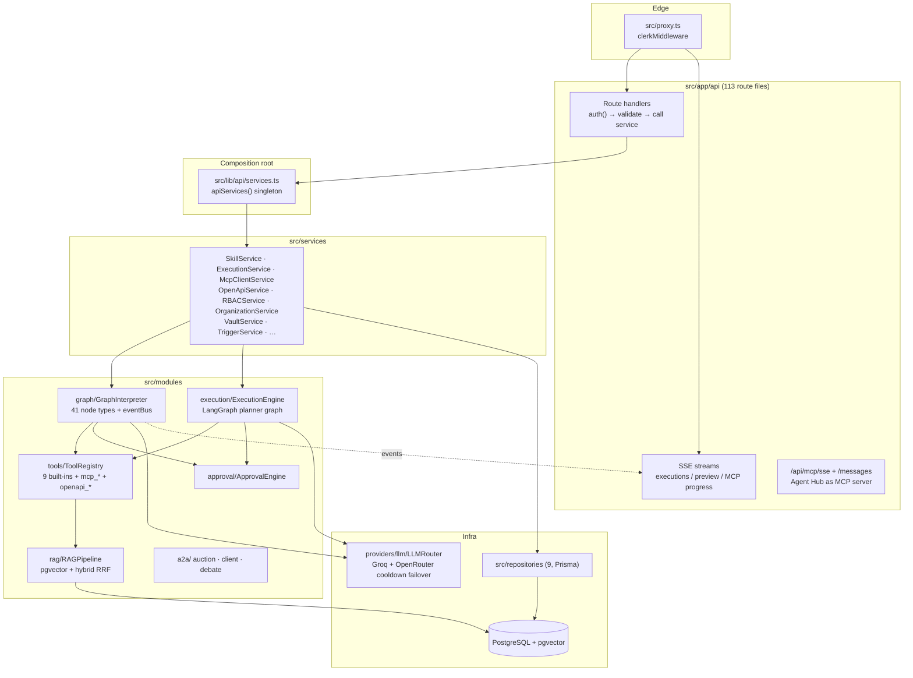

# Agent Hub — Backend Reference

> **Agent Hub** (npm package `agent-studio`, v0.6) is a visual AI-agent and multi-agent orchestration platform. You build agent graphs on a canvas, version them as **skills**, and execute them with:
> - Human-in-the-Loop (HITL) approval gates
> - MCP client and server support
> - OpenAPI tool import
> - RAG over pgvector
> - A2A agent delegation
> - live SSE telemetry
>
> This document covers everything server-side: the API routes, services, runtime modules, LLM providers, database, configuration and backend tests. UI pages, components and styling are in **[frontend.md](frontend.md)**. Setup and contribution workflow are in **[README.md](README.md)**.

Every file listed here was checked against the source on 2026-10-28. Where the code and older docs disagreed, this file follows the code.

## Contents
1. [Stack](#stack)
2. [Commands](#commands)
3. [Architecture](#architecture)
4. [Backend Conventions (as practiced)](#backend-conventions-as-practiced)
5. [Configuration & Local Services](#configuration--local-services)
6. [Database (`prisma/`)](#database-prisma)
7. [API Routes](#api-routes-srcappapi), with the [Skills API Reference](#skills-api-reference)
8. [Runtime Modules (`src/modules/`)](#runtime-modules-srcmodules)
9. [LLM Providers (`src/providers/llm/`)](#llm-providers-srcprovidersllm)
10. [Services (`src/services/`)](#services-srcservices)
11. [Repositories (`src/repositories/`)](#repositories-srcrepositories)
12. [Shared Library (`src/lib/`)](#shared-library-srclib)
13. [Types & Validators](#types--validators)
14. [Backend Tests](#backend-tests-testsunit-testsintegration-testsperformance)
15. [Backend Root Files](#backend-root-files)

## Stack
| Concern | Technology (from `package.json`) |
|---|---|
| Runtime / framework | Next.js `^16.4.3` App Router route handlers, Node.js, TypeScript `~5.9.3` (strict) |
| Auth | Clerk `@clerk/nextjs ^7.9.22`, enforced at the edge by [`src/proxy.ts`](src/proxy.ts); org API keys on selected routes |
| Database | PostgreSQL with the `vector` extension (pgvector), through Prisma `^6.19.3` (`@prisma/client`) |
| Agent runtime | A custom `GraphInterpreter` for canvas graphs, plus `@langchain/langgraph ^1.5.3` for the planner engine |
| MCP | `@modelcontextprotocol/sdk ^1.32.2`, in both client and server roles |
| LLMs | Groq, OpenRouter and any OpenAI-compatible endpoint, called with raw `fetch` (no vendor SDKs) |
| Validation / logging | Zod `3.25.76` and Pino `^10.4.0` |
| Document parsing | `pdf-parse`, `mammoth`, `turndown`, `js-yaml` |
| Tests | Vitest `^5.0.5`; Playwright for e2e (see [frontend.md](frontend.md)) |

## Commands
| Command | Purpose |
|---|---|
| `npm install` | Installs dependencies; `postinstall` runs `prisma generate`. |
| `npm run db:migrate` | Applies migrations (`prisma migrate deploy`). Use this for a fresh database; see [Database](#database-prisma). |
| `npm run db:generate` / `db:push` / `db:studio` / `db:seed` | Prisma generate, schema sync without migrations, studio, and seed (`tsx prisma/seed.ts`). |
| `npm run dev` | Starts the Next dev server on :3000 with Turbopack. `dev:webpack` uses webpack instead. |
| `npm run build` / `start` | Production build and serve. |
| `npm run typecheck` | `tsc --noEmit`. |
| `npm run lint` | `eslint .`. |
| `npm test` / `test:unit` / `test:integration` / `test:performance` / `test:all` / `test:watch` | Vitest suites; see [Backend Tests](#backend-tests-testsunit-testsintegration-testsperformance). |
| `docker compose up -d [service]` | Starts local Postgres and optional node microservices; see [Local services](#local-services-docker-composeyml). |

## Architecture

**Which engine runs a skill.** [`ExecutionService`](src/services/ExecutionService.ts) checks the skill version:
- If it has a valid `graphDefinition` (`isValidGraph`), the **GraphInterpreter** walks the canvas graph.
- Otherwise the **ExecutionEngine** runs the fixed LangGraph planner graph.
  - Its loop is planner → permission → tool_selection ⇄ tool_execution → finish.
  - An approval branch pauses the run when needed.

**Execution statuses** (`ExecutionStatus`): `PENDING`, `RUNNING`, `PAUSED_FOR_APPROVAL`, `COMPLETED`, `FAILED`, `CANCELLED`, `STEP_LIMIT_EXCEEDED`.

**Event streaming.** [`executionEventBus`](src/modules/graph/eventBus.ts) is an in-process singleton. It has 19 event kinds:
- **Node:** `node:start`, `node:end`, `node:token_chunk`
- **Flow:** `edge:traverse`, `execution:status`, `log`, `router:decision`, `loop:iteration`, `parallel:branch`
- **Calls:** `tool:call:start/end`, `llm:call:start/end`, `mcp:tool:start/end`
- **Approvals:** `approval:requested/resolved`
- **A2A:** `a2a:task:delegated`, `a2a:message:exchange`

SSE routes subscribe to it. Because it is single-process, scaling out would need a shared bus such as Redis.

## Backend Conventions (as practiced)
These rules came from the old CONTRIBUTING guide and were re-checked against the code. Where the code currently deviates, the deviation is noted after the rule.

1. **Layering.** Route handler → service → repository → Prisma. Handlers should be thin: `auth()` → parse → validate → call one service method → respond.
   - **Composition root.** Services come from the `globalThis` singleton [`apiServices()`](src/lib/api/services.ts).
   - **Interfaces.** All 9 repositories implement `I*Repository` interfaces. Only 6 of 17 services have interfaces (A2A, Approval, Execution, McpClient, OpenApi, Skill).
   - *Deviation:* these services call `prisma` directly: ApiKey, Audit, CustomRole, DashboardStats, Memory, Organization, PlanLimits, RBAC, Trigger, Vault.
   - *Deviation:* `TriggerService` creates its own `ExecutionService`, so cron and webhook runs use a separate `CancellationManager`.
2. **Zod at the edge.** Request schemas live in [`src/validators/`](src/validators/).
   - Use `.parse()` for bodies; a ZodError becomes 400 `VALIDATION_ERROR` with `fields`.
   - Use `.safeParse()` for query strings.
   - *Deviation:* 8 routes define inline schemas, and the org, vault, trigger and API-key routes have no validator files.
3. **Errors.** Use the helpers in [`src/lib/api/handlers.ts`](src/lib/api/handlers.ts) and throw the typed errors from [`src/lib/api/errors.ts`](src/lib/api/errors.ts).
   - The envelope is `{ success: true, data }` or `{ success: false, error, code, fields? }`.
   - Never return `error.message` in a 500.
   - Not-found and no-access both return **404**, so IDs are not leaked.
   - *Deviation:* plain `Error`s thrown from repositories, such as business-rule violations, surface as 500. See [Skills API](#skills-api-reference).
4. **Ownership.** Scope every query to `userId` with the `*ForUser` repository methods. Org access goes through `RBACService`.
   - The global `User.role = "ADMIN"` is a super-admin bypass for every RBAC and ownership check (`RBACService.isSuperAdmin`; `SkillRepository` returns all users' skills to an ADMIN).
   - [`ensureUserExists`](src/lib/user.ts) creates users as `USER` and never rewrites the role. Promote admins explicitly in the database.
5. **Logging.** Use `import { logger } from "@/lib/logger"` (Pino), with the context object first: `logger.info({ skillId }, "Publishing skill version")`.
   - Mutations also write audit rows with `UPPER_SNAKE_CASE` actions.
   - *Deviation:* about 25 `console.*` calls remain in `src`.
6. **LLM access goes through `LLMProvider`.** Use `getLLMProvider()` or `getProviderForModel()`. To add a vendor, write a provider class and add it to the roster in `modelLists.ts`.
   - *Deviation:* `rag/embeddingService.ts` calls the Groq and OpenRouter embedding endpoints directly.
7. **Planner engine graph.** Nodes read and write `AgentState` and receive their dependencies through `config.configurable.runtime`. New capabilities are a new node plus an edge in [`buildExecutionGraph.ts`](src/modules/execution/graph/buildExecutionGraph.ts).
8. **Prisma.** [`schema.prisma`](prisma/schema.prisma) is the source of truth. Sync it with `npm run db:push`, and wrap multi-step writes in `prisma.$transaction`. Map rows to DTOs in `src/types/`.
9. **Env vars.** Add new variables to `.env.example` and to the Zod schema in [`src/lib/config/env.ts`](src/lib/config/env.ts), then read them through `env`.
   - **Bearer secrets** (`CRON_SECRET`, `A2A_ACCESS_TOKEN`) are checked with [`bearerTokenMatches`](src/lib/api/bearer.ts): constant-time, and rejecting everything when the secret is unset.
   - **User-supplied URLs** fetched by the server should go through [`fetchPublicUrl`](src/lib/net/publicFetch.ts).
   - *Deviation:* 18 files read `process.env` directly. The `VAULT_*`, `*_HOST`, `SMITHERY_API_KEY` and `GITHUB_TOKEN` variables are not in `env.ts`.
10. **TypeScript.**
    - Strict mode; avoid `any` (ESLint warns on it).
    - Use the `@/` alias for imports from `src`.
    - Use async/await, and `Promise.all` for parallel calls.
    - Formatting: 2-space indent, double quotes, semicolons.
11. **Tests.** Every service and domain unit gets a Vitest suite under `tests/unit/`, mirroring `src/`. Inject fakes through constructors; never mock Prisma for repository-backed services.

## Configuration & Local Services

### Environment variables (`.env.example`)
Copy `.env.example` to `.env`. Prisma CLI commands read `.env` only; Next also reads `.env.local`.

| Variable | Purpose |
|---|---|
| `DATABASE_URL` | **Required.** PostgreSQL connection string; the database needs the pgvector extension. |
| `NEXT_PUBLIC_CLERK_PUBLISHABLE_KEY`, `CLERK_SECRET_KEY` | **Required.** Clerk auth. Without them, Clerk runs in keyless dev mode and caches keys in `.clerk/`, which must not be committed. |
| `GROQ_API_KEY`, `OPENROUTER_API_KEY` | At least one is needed for LLM execution. Both are also used for embeddings. |
| `OPENAI_API_KEY` | Used only by the live model listing. Not used for embeddings. |
| `NEXT_PUBLIC_APP_URL` | App base URL, sent as the OpenRouter `HTTP-Referer`. Derived from `VERCEL_URL` when unset. |
| `MCP_ACCESS_TOKEN` | Bearer token for external MCP clients on `/api/mcp/sse` and `/api/mcp/messages`. |
| `COMPOSIO_API_KEY`, `ARCADE_API_KEY`, `SMITHERY_API_KEY`, `GITHUB_TOKEN` | Access to the MCP catalogs and directories. `GITHUB_TOKEN` raises the GitHub rate limit. |
| `VAULT_MASTER_KEY`, `VAULT_KEY_VERSIONS` | Vault encryption master key (64 hex characters, required in production) and the active key versions (default `1`). |
| `SEARXNG_HOST`, `CRAWL4AI_HOST`, `DOCLING_HOST`, `GOTENBERG_HOST`, `NOCODB_HOST`, `NOCODB_API_TOKEN`, `POCKETBASE_HOST`, `QDRANT_HOST`, `QDRANT_API_KEY`, `WHISPER_HOST`, `PIPER_TTS_HOST` | Default URLs for the graph-node microservices. Each node can also set its own URL. |
| `LOG_LEVEL`, `NODE_ENV` | Logging level and runtime mode. |
| `A2A_REGISTRY_URL`, `A2A_REGISTRY_TOKEN` | Optional upstream A2A agent registry. |
| `A2A_ACCESS_TOKEN` | Bearer token external agents send to `/api/a2a/tasks`. When unset, only signed-in sessions may call it. |
| `CRON_SECRET` | Bearer secret required by `/api/triggers/cron/[id]` (Vercel Cron sends it automatically). When unset, cron triggers are rejected with 503. |

**Read by code but missing from `.env.example`:**
- `SEED_USER_ID`: the seed script's demo user.
- `OLLAMA_HOST`: the embedding fallback.
- `NEXTAUTH_SECRET`: a leftover in `env.ts`.

**`NODE_ENV` and builds.** If `.env` sets `NODE_ENV=development`, build with `NODE_ENV=production npm run build`.

### Local services (`docker-compose.yml`)
| Service | Image | Host port | Used by |
|---|---|---|---|
| `postgres` | `pgvector/pgvector:pg16` (db `agentstudio`, user `agent`) | 5432 | Everything |
| `searxng` | `searxng/searxng` | 8080 | `searxng_search` node |
| `crawl4ai` | `unclecode/crawl4ai` | 11235 | `crawl4ai_scrape` node |
| `docling` | `docling-serve` | 5001 | `docling_pdf_parser` node |
| `gotenberg` | `gotenberg/gotenberg:8` | **3000** | `gotenberg_pdf_exporter` node |
| `nocodb` | `nocodb/nocodb` | 8085 | `nocodb_record` node and the `record_lookup` tool |
| `pocketbase` | `muchobien/pocketbase` | 8090 | `pocketbase_store` node |
| `qdrant` | `qdrant/qdrant` | 6333/6334 | `qdrant_vector_memory` node |
| `whisper` | `faster-whisper-server` (CUDA image by default) | 8000 | `audio_transcriber` node |
| `piper` | `rhasspy/wyoming-piper` | 5000 | `piper_tts` node |

Gotenberg uses host port 3000, the same port as `next dev`. Start only the services you need, e.g. `docker compose up -d postgres searxng`.

## Database (`prisma/`)
- **Datasource:** `postgresql` with `extensions = [vector]`.
- **Generator:** `prisma-client-js` with the `postgresqlExtensions` preview feature.
- **Size:** 29 models and 14 enums.

| Area | Models |
|---|---|
| Users & skills | `User` (Clerk id, role USER/ADMIN), `Skill` (draft/published pointers, soft-delete `deletedAt`, optional org), `SkillVersion` (schemas, instructions, tools, `approvalPolicy`, `graphDefinition`) |
| Executions | `Execution`, `ExecutionLog`, `ExecutionStep` (per-node snapshot), `ToolCall` |
| HITL | `ApprovalRequest` (unique `idempotencyKey`), `ApprovalHistory` |
| Tools & integrations | `ToolDefinition` (the built-in catalog), `McpServer`, `McpSession`, `OpenApiIntegration` |
| Audit & comparison | `AuditLog`, `VersionComparison` |
| Secrets | `VaultEntry` (`iv`, `tag`, `keyVersion`) |
| RAG | `Document`, `DocumentChunk` (`Float[] embedding` plus an `Unsupported("vector") embedding_vector` column) |
| Evals | `EvalRunReport` |
| Tenancy & RBAC | `Organization`, `OrganizationMember`, `Invitation`, `CustomRole`, `ApiKey`, `BudgetPolicy` |
| Automation & memory | `WebhookTrigger`, `CronSchedule`, `AgentMemory`, `Task` |

**Enums:**

| Enum | Values |
|---|---|
| `Role` | USER, ADMIN |
| `SkillStatus` | DRAFT, PUBLISHED, ARCHIVED |
| `ExecutionStatus` | see [Architecture](#architecture) |
| `StepStatus` | RUNNING, SUCCESS, FAILED, SKIPPED, AWAITING_APPROVAL |
| `ApprovalStatus` | PENDING, APPROVED, REJECTED, EXPIRED |
| `ToolType` | READ, WRITE |
| `McpTransport` | SSE, STDIO |
| `McpServerStatus` | CONNECTED, DISCONNECTED, ERROR |
| `OpenApiAuthType` | NONE, BEARER, API_KEY, BASIC, CUSTOM_HEADER |
| `OpenApiStatus` | CONNECTED, ERROR |
| `VaultCategory` | 8 values |
| `TaskStatus` | 4 values |
| `TaskPriority` | 4 values |
| `OrgRole` | OWNER, ADMIN, MEMBER, VIEWER |

**Migrations.** [`prisma/migrations/0_init`](prisma/migrations/0_init/migration.sql) is a single baseline generated from the schema. It replaced four incremental migrations that could not build a fresh database.
- **Fresh database:** `npm run db:migrate`.
- **Database previously synced with `db push`:** mark the baseline as applied once with `npx prisma migrate resolve --applied 0_init`. After that, use `db:migrate`.
- **Schema changes:** run `npx prisma migrate dev --name <change>` against a development database to add a migration.

**Vector index.** `DocumentChunk.embedding_vector` deliberately has no Prisma `@@index`.
- [`PgVectorStore`](src/modules/rag/pgvectorStore.ts) creates an IVFFlat index named `document_chunks_embedding_vector_idx` at runtime.
- A Prisma btree index would take that name and could not hold high-dimensional vectors.
- If an older `db push` created the btree index, drop it (`DROP INDEX document_chunks_embedding_vector_idx;`) so the IVFFlat index can be built.

| File | Purpose |
|---|---|
| [`prisma/schema.prisma`](prisma/schema.prisma) | PostgreSQL + pgvector schema: 29 models, 14 enums. |
| [`prisma/seed.ts`](prisma/seed.ts) | Idempotent upsert seed. Run it with `SEED_USER_ID=<clerk id> npm run db:seed`. It creates: • 8 built-in `ToolDefinition`s • the demo user (`SEED_USER_ID` or `user_demo_agent_studio`) • 8 MCP presets (GitHub, Postgres, SQLite, Web Fetch, Brave, Filesystem, Slack, Memory) • the published skill "Customer Refund Bounded Workflow" • the org `agent-studio-demo` with a "Skill Operator" custom role and an auditor member |
| [`prisma/migrations/0_init/migration.sql`](prisma/migrations/0_init/migration.sql) | Baseline migration generated with `prisma migrate diff --from-empty`: the `vector` extension, all 14 enums, all 29 tables, their indexes and foreign keys. |
| [`prisma/migrations/migration_lock.toml`](prisma/migrations/migration_lock.toml) | Prisma migration lock (provider `postgresql`). |

## API Routes (`src/app/api/`)

There are **113 route files**: 112 under `src/app/api/**` plus [`src/app/.well-known/agent.json/route.ts`](src/app/.well-known/agent.json/route.ts).

### Auth, rate limiting & error envelope

**Proxy** ([`src/proxy.ts`](src/proxy.ts)):
- It runs Clerk `auth.protect()` on every `/api/*` path, plus `/dashboard`, `/executions`, `/versions` and `/approvals`.
- **Public routes**, for external callers. Each handler authenticates the caller itself:

  | Route | Handler auth |
  |---|---|
  | `/api/health` | None (no data) |
  | `/api/mcp/sse*`, `/api/mcp/messages*` | Clerk session or `MCP_ACCESS_TOKEN` |
  | `/api/triggers/webhook/*` | Secret token, plus HMAC when configured |
  | `/api/triggers/cron/*` | `CRON_SECRET` |
  | `/api/a2a/manifest` | None (public agent card) |
  | `/api/a2a/tasks` | Clerk session or `A2A_ACCESS_TOKEN` |
- **API-key requests.** Requests to `/api/*` that carry an API key (`X-API-Key`, or `Authorization: Bearer as_…`) skip the session check so the handler can validate the key. Routes that don't accept keys still call `auth()` and return 401.
- Signed-in users who open `/` are redirected to `/dashboard`.

**Handler pattern.** Nearly every handler starts with `const { userId } = await auth(); if (!userId) return unauthorized();`.
- In the tables below, **Clerk** means the handler checks for itself.
- **proxy-only** means the handler has no check and relies on the proxy.
- **Key** means the route also accepts an org API key.

**Org API keys** are handled by [`resolveRequestAuth`](src/lib/api/middleware/apiKeyAuth.ts). A key acts as the user who created it, under these rules:
- **Org-pinned.** It works only inside the key's organization. It never reaches the creator's personal resources; anything outside the org returns 404.
- **Scoped.** It is limited to its scopes (`*` or e.g. `skills:read`); a missing scope returns 403.
- **RBAC still applies.** The creator's org RBAC is checked on top of the scopes.
- **Revoked on departure.** It stops working when the creator leaves the org.
- **Headers only.** Keys are read from headers, never from the query string. An invalid key is a 401, with no fallback to the session.

Routes that accept keys:

| Route | Scope |
|---|---|
| `GET /api/skills` | `skills:read` |
| `POST /api/skills` | `skills:create` |
| `GET /api/skills/[id]` | `skills:read` |
| `GET /api/executions` | `executions:read` |
| `POST /api/executions` | `executions:create` |
| `GET /api/executions/[id]` | `executions:read` |
| `GET /api/executions/[id]/detail` | `executions:read` |
| `POST /api/executions/[id]/cancel` | `executions:cancel` |

**Org context**:
- Routes read the org from the `X-Organization-Id` header, or from `organizationId` in the query or body.
- They check access inline through `rbacService`: `getOrgMembership`, the `getUserOrgPermissions` flags (`canManageMembers`, `canViewAuditLog`, `canExecuteSkill`, `canManageSettings`) and `hasPermission(..., "skills:create" | "mcp:create" | "vault:create")`.
- `/api/organizations/**` routes leave RBAC to the services, which throw `ForbiddenError` (→ 403).
- A user whose `User.role` is `ADMIN` is a super-admin and bypasses resource checks.

**Rate limit (RL)** — [`src/lib/api/rateLimit.ts`](src/lib/api/rateLimit.ts):
- An in-process sliding window allowing 20 requests/min per key.
- Over the limit it returns 429 `RATE_LIMITED` with a `Retry-After` header.
- It works on a single instance only.

**Body limit** — [`src/lib/api/bodyLimit.ts`](src/lib/api/bodyLimit.ts): `parseJsonBody` caps bodies at 1MB (413 `PAYLOAD_TOO_LARGE`). Only `POST /api/skills` uses it.

**Error envelope** — [`src/lib/api/handlers.ts`](src/lib/api/handlers.ts): errors are returned as `{ success: false, error, code?, fields? }`.

| Status | Code | Source |
|---|---|---|
| 400 | `VALIDATION_ERROR` + `fields` | Zod issues |
| 400 | `BAD_REQUEST` | Bad input; `SyntaxError` → "Invalid JSON body" |
| 401 | `UNAUTHENTICATED` | `unauthorized()` |
| 403 | `FORBIDDEN` | `forbidden()`, `ForbiddenError` |
| 404 | `NOT_FOUND` | `notFound()`, `NotFoundError` |
| 500 | `INTERNAL_ERROR` | Always a generic message; the real error is only logged |

**Fallback for a plain `Error` in `handleApiError`:**
- A message containing "not found" or "not have access" → 404.
- A message containing "access" or "permission" → 403.
- Anything else → 500.

**Envelope inconsistencies.** These routes return a bare `{ error }`: `rag/*`, `vault/*`, `canvas/preview`, `evals/*`, `mcp/updates`, `skills/packs`, `skills/sandbox` and `skills/synthesize`. `a2a/tasks` returns an A2A-shaped body.

**SSE endpoints:**
- `executions/[id]/stream`
- `canvas/preview/[id]/stream`
- `mcp/servers/[id]/progress`
- `a2a/tasks?stream=true`
- `mcp/sse` (via the MCP transport)

**Unused middleware.** [`middleware/rbac.ts`](src/lib/api/middleware/rbac.ts) and [`middleware/ownership.ts`](src/lib/api/middleware/ownership.ts) exist, but no route imports them. Only tests use `ownership.ts`.

### Known issues
- **Remaining SSRF exposure.** `rag/fetch-url` is guarded by [`fetchPublicUrl`](src/lib/net/publicFetch.ts). These routes still fetch user-supplied URLs without it, because they legitimately reach local services in development:
  - `openapi/parse` and `openapi/test-raw`
  - `mcp/directory/health`
  - `a2a/discover?url=`
  - the graph's `http` and `web_reader` nodes

  Restrict server egress in production.
- **Existing super-admins.** Databases created before 2026-10-28 have every user stored as `ADMIN`. Demote them with `UPDATE users SET role = 'USER' WHERE role = 'ADMIN';`, then re-promote real admins.
- **Stub endpoints.** `POST`/`DELETE` on `skills/[id]/permissions` persist nothing, and `POST mcp/compositions` saves nothing.
- **Viewer permissions.** Org VIEWERs can archive, restore, duplicate and publish org skills, because `findByIdForUser` allows any org member.

### .well-known
| File | Methods | Notes |
|---|---|---|
| [`src/app/.well-known/agent.json/route.ts`](src/app/.well-known/agent.json/route.ts) | `GET`, `OPTIONS` | Re-exports the A2A manifest with CORS `*`. Public, because the path is outside `/api`. |

### a2a
| File | Methods | Notes |
|---|---|---|
| [`src/app/api/a2a/auction/route.ts`](src/app/api/a2a/auction/route.ts) | `POST` | Runs a task auction across the A2A registry (`title` and `description` required) and can execute the winner. Clerk; RL. |
| [`src/app/api/a2a/discover/route.ts`](src/app/api/a2a/discover/route.ts) | `GET` | Without `?url`, returns registry presets. With `?url`, fetches a remote agent manifest (Clerk; RL). |
| [`src/app/api/a2a/manifest/route.ts`](src/app/api/a2a/manifest/route.ts) | `GET`, `OPTIONS` | Static A2A agent manifest with CORS `*`; advertises `auth: bearer`. **Public.** |
| [`src/app/api/a2a/messages/route.ts`](src/app/api/a2a/messages/route.ts) | `POST`, `OPTIONS` | One A2A debate turn: an LLM reply, with an optional session transcript kept in an owner-checked in-memory store. Clerk; RL; Zod `A2AMessageSchema`. |
| [`src/app/api/a2a/tasks/route.ts`](src/app/api/a2a/tasks/route.ts) | `POST`, `OPTIONS` | Inbound A2A task delegation answered by the LLM. `?stream=true` streams SSE chunks ending in `[DONE]`. Public in the proxy; the handler requires a Clerk session or `Bearer A2A_ACCESS_TOKEN`. |

### approvals
| File | Methods | Notes |
|---|---|---|
| [`src/app/api/approvals/route.ts`](src/app/api/approvals/route.ts) | `GET`, `POST` | GET lists the caller's approvals with history; in an org, it lists all org approvals and needs `canManageMembers`. POST approves or rejects; anyone other than the requester must be org OWNER/ADMIN. Clerk; RL on POST; Zod `respondApprovalSchema`. |
| [`src/app/api/approvals/[id]/cancel/route.ts`](src/app/api/approvals/[id]/cancel/route.ts) | `POST` | Cancels a pending approval. Clerk; inline Zod `{ idempotencyKey }`. |

### audit, compare, dashboard, docs, health, invitations, settings
| File | Methods | Notes |
|---|---|---|
| [`src/app/api/audit/route.ts`](src/app/api/audit/route.ts) | `GET` | The user's audit log, filtered by `search`, `action`, `from`/`to` and `limit`; `export=1` exports it. Clerk. |
| [`src/app/api/compare/route.ts`](src/app/api/compare/route.ts) | `GET` | Diffs two skill versions (`versionA`, `versionB`). Clerk. |
| [`src/app/api/dashboard/stats/route.ts`](src/app/api/dashboard/stats/route.ts) | `GET` | Dashboard stats for `timeRange` = `24h`, `7d` (default), `30d` or `all`. Clerk. |
| [`src/app/api/docs/route.ts`](src/app/api/docs/route.ts) | `GET` | Serves the OpenAPI spec built in `src/lib/api/openapi.ts` (cached 1h, CORS `*`). proxy-only. |
| [`src/app/api/health/route.ts`](src/app/api/health/route.ts) | `GET` | Returns `{ status: "ok", service, timestamp }`. **Public.** Does not check the DB. |
| [`src/app/api/invitations/[token]/accept/route.ts`](src/app/api/invitations/[token]/accept/route.ts) | `POST` | Accepts an org invitation. Clerk. |
| [`src/app/api/settings/providers/route.ts`](src/app/api/settings/providers/route.ts) | `GET` | Groq/OpenRouter configured flags, model rosters and `runtimeReady`. Clerk. |

### benchmarks & evals
| File | Methods | Notes |
|---|---|---|
| [`src/app/api/benchmarks/compare/route.ts`](src/app/api/benchmarks/compare/route.ts) | `POST` | Runs one benchmark suite across `models[]`. proxy-only. |
| [`src/app/api/benchmarks/run/route.ts`](src/app/api/benchmarks/run/route.ts) | `POST` | Runs a suite for a single model and returns a scorecard. proxy-only. |
| [`src/app/api/benchmarks/suites/route.ts`](src/app/api/benchmarks/suites/route.ts) | `GET` | Lists the built-in benchmark suites. proxy-only. |
| [`src/app/api/evals/compare/route.ts`](src/app/api/evals/compare/route.ts) | `GET` | Compares two eval runs (`runA`, `runB`) owned by the user. Clerk. |
| [`src/app/api/evals/datasets/route.ts`](src/app/api/evals/datasets/route.ts) | `GET`, `POST` | Lists eval datasets, or creates a custom one (`name` and `items[]`). proxy-only. |
| [`src/app/api/evals/run/route.ts`](src/app/api/evals/run/route.ts) | `POST` | Runs an LLM-judge evaluation on `datasetId`. Clerk. |
| [`src/app/api/evals/runs/route.ts`](src/app/api/evals/runs/route.ts) | `GET` | Lists the user's eval reports. Clerk. |

### canvas
| File | Methods | Notes |
|---|---|---|
| [`src/app/api/canvas/copilot/route.ts`](src/app/api/canvas/copilot/route.ts) | `POST` | Turns a natural-language prompt into an LLM-generated `AgentGraphDefinition`. Clerk; RL. |
| [`src/app/api/canvas/optimize-prompt/route.ts`](src/app/api/canvas/optimize-prompt/route.ts) | `POST` | Has the LLM rewrite a node's system prompt and returns token stats. Clerk; RL. |
| [`src/app/api/canvas/preview/route.ts`](src/app/api/canvas/preview/route.ts) | `POST` | Validates `skillVersionId`, `graph` and input, registers a dry-run preview session, and returns `{ previewId }`. Clerk. |
| [`src/app/api/canvas/preview/[id]/stream/route.ts`](src/app/api/canvas/preview/[id]/stream/route.ts) | `GET` | **SSE.** Starts the ghost/dry-run graph run and streams events, with a 15s ping. Clerk; checks the session owner. |

### executions
| File | Methods | Notes |
|---|---|---|
| [`src/app/api/executions/route.ts`](src/app/api/executions/route.ts) | `GET`, `POST` | GET lists and filters executions (`status`, `sortBy`, `sortOrder`, `limit`, `from`/`to`, `search`, `skillName`); org members with `canViewAuditLog` see all org runs. POST starts an execution (201); in an org it needs `canExecuteSkill`, and an API key may only run skills of its own org. Clerk or Key; RL on POST; Zod `startExecutionSchema`. |
| [`src/app/api/executions/metrics/route.ts`](src/app/api/executions/metrics/route.ts) | `GET` | The user's execution metrics. Clerk. |
| [`src/app/api/executions/[id]/route.ts`](src/app/api/executions/[id]/route.ts) | `GET` | One execution, for its owner or an org member allowed by `canAccessResource`. Otherwise 404. Clerk or Key. |
| [`src/app/api/executions/[id]/cancel/route.ts`](src/app/api/executions/[id]/cancel/route.ts) | `POST` | Cancels the user's execution. Clerk or Key. |
| [`src/app/api/executions/[id]/detail/route.ts`](src/app/api/executions/[id]/detail/route.ts) | `GET` | Full execution detail, including steps and logs. Clerk or Key. |
| [`src/app/api/executions/[id]/export/route.ts`](src/app/api/executions/[id]/export/route.ts) | `GET` | Exports an execution report. Clerk. |
| [`src/app/api/executions/[id]/replay/route.ts`](src/app/api/executions/[id]/replay/route.ts) | `POST` | Replays the execution as a new run (201). Clerk; RL. |
| [`src/app/api/executions/[id]/resume/route.ts`](src/app/api/executions/[id]/resume/route.ts) | `POST` | Resumes after approval: validates the approval, resumes the run and writes an audit entry. Clerk; RL; inline Zod. |
| [`src/app/api/executions/[id]/retry/route.ts`](src/app/api/executions/[id]/retry/route.ts) | `POST` | Retries a failed execution. Clerk; RL. |
| [`src/app/api/executions/[id]/stream/route.ts`](src/app/api/executions/[id]/stream/route.ts) | `GET` | **SSE.** Live execution events from the event bus. Clerk; owner-checked. |

### mcp
| File | Methods | Notes |
|---|---|---|
| [`src/app/api/mcp/arcade/route.ts`](src/app/api/mcp/arcade/route.ts) | `GET`, `POST` | GET returns a static list of Arcade integrations. POST returns the MCP URL and headers for one integration (Clerk). Needs `ARCADE_API_KEY`. |
| [`src/app/api/mcp/composio/route.ts`](src/app/api/mcp/composio/route.ts) | `GET`, `POST` | GET lists Composio toolkits. POST creates a Composio session and returns its MCP URL (Clerk). Needs `COMPOSIO_API_KEY`. |
| [`src/app/api/mcp/compositions/route.ts`](src/app/api/mcp/compositions/route.ts) | `GET`, `POST` | GET lists server compositions parsed from awesome-mcp. POST builds a composition but does **not** persist it. Clerk. |
| [`src/app/api/mcp/directory/route.ts`](src/app/api/mcp/directory/route.ts) | `GET` | MCP directory combining a curated list, awesome-mcp-servers and Smithery. Filters: `q`, `category`, `source`, `transport`, `language`. Clerk; `revalidate=3600`. |
| [`src/app/api/mcp/directory/github/route.ts`](src/app/api/mcp/directory/github/route.ts) | `GET` | Fetches the GitHub release and README for `?repo`. Clerk. |
| [`src/app/api/mcp/directory/health/route.ts`](src/app/api/mcp/directory/health/route.ts) | `POST` | Probes `endpointUrl` with a 10s timeout and reports healthy, degraded or unreachable. Clerk. |
| [`src/app/api/mcp/messages/route.ts`](src/app/api/mcp/messages/route.ts) | `POST` | Message endpoint for Agent Hub's MCP-server sessions, routed by the `mcp-session-id` header. Public in the proxy; the handler requires a Clerk session or `Bearer MCP_ACCESS_TOKEN`. |
| [`src/app/api/mcp/presets/route.ts`](src/app/api/mcp/presets/route.ts) | `GET` | Returns the `MCP_PRESETS` catalog. Clerk. |
| [`src/app/api/mcp/quality/route.ts`](src/app/api/mcp/quality/route.ts) | `POST` | Scores `servers[]` on schema quality, a latency probe and reliability, and assigns badges. Clerk. |
| [`src/app/api/mcp/servers/route.ts`](src/app/api/mcp/servers/route.ts) | `GET`, `POST` | Lists the user's or the org's MCP servers, or creates one (201; in an org it needs `mcp:create`). Clerk; Zod `createMcpServerSchema`. |
| [`src/app/api/mcp/servers/batch/route.ts`](src/app/api/mcp/servers/batch/route.ts) | `POST` | Batch connect, disconnect or health-check for `serverIds`. Clerk; inline Zod. |
| [`src/app/api/mcp/servers/export/route.ts`](src/app/api/mcp/servers/export/route.ts) | `GET` | Exports the user's server configs as JSON. Clerk. |
| [`src/app/api/mcp/servers/import/route.ts`](src/app/api/mcp/servers/import/route.ts) | `POST` | Imports server configs. Clerk; inline Zod. |
| [`src/app/api/mcp/servers/[id]/route.ts`](src/app/api/mcp/servers/[id]/route.ts) | `GET`, `PATCH`, `DELETE` | Get, update or delete a server the user owns. Clerk; Zod `updateMcpServerSchema`. |
| [`src/app/api/mcp/servers/[id]/connect/route.ts`](src/app/api/mcp/servers/[id]/connect/route.ts) | `POST` | Connects to the server and discovers its tools. Clerk. |
| [`src/app/api/mcp/servers/[id]/disconnect/route.ts`](src/app/api/mcp/servers/[id]/disconnect/route.ts) | `POST` | Disconnects the server. Clerk. |
| [`src/app/api/mcp/servers/[id]/discover/route.ts`](src/app/api/mcp/servers/[id]/discover/route.ts) | `POST` | Rediscovers tools (`tools/list`). Clerk. |
| [`src/app/api/mcp/servers/[id]/health/route.ts`](src/app/api/mcp/servers/[id]/health/route.ts) | `GET` | Health check. Clerk. |
| [`src/app/api/mcp/servers/[id]/metrics/route.ts`](src/app/api/mcp/servers/[id]/metrics/route.ts) | `GET` | Per-server call metrics. Clerk. |
| [`src/app/api/mcp/servers/[id]/progress/route.ts`](src/app/api/mcp/servers/[id]/progress/route.ts) | `GET` | **SSE** stream of MCP progress notifications. Clerk. |
| [`src/app/api/mcp/servers/[id]/prompts/route.ts`](src/app/api/mcp/servers/[id]/prompts/route.ts) | `GET`, `POST` | Lists the server's prompts, or gets one by `{ name, arguments }`. Clerk. |
| [`src/app/api/mcp/servers/[id]/resources/route.ts`](src/app/api/mcp/servers/[id]/resources/route.ts) | `GET` | Lists the server's resources. Clerk. |
| [`src/app/api/mcp/servers/[id]/resources/read/route.ts`](src/app/api/mcp/servers/[id]/resources/read/route.ts) | `POST` | Reads the resource at `uri`. Clerk; inline Zod. |
| [`src/app/api/mcp/servers/[id]/sampling/route.ts`](src/app/api/mcp/servers/[id]/sampling/route.ts) | `POST` | Handles an MCP sampling request. Clerk; inline Zod. |
| [`src/app/api/mcp/servers/[id]/test/route.ts`](src/app/api/mcp/servers/[id]/test/route.ts) | `POST` | Test-invokes a tool (`toolName`, `arguments`). Clerk; Zod `mcpTestToolSchema`. |
| [`src/app/api/mcp/skills-feed/route.ts`](src/app/api/mcp/skills-feed/route.ts) | `GET` | Paginated skills marketplace feed from Glama, mcp.so, Smithery and Composio. Clerk; `revalidate=300`. |
| [`src/app/api/mcp/smithery/route.ts`](src/app/api/mcp/smithery/route.ts) | `GET` | Smithery registry proxy: `action=detail` for one server, otherwise a list. Returns 502 on upstream failure. Clerk. |
| [`src/app/api/mcp/sse/route.ts`](src/app/api/mcp/sse/route.ts) | `GET`, `POST` | **Agent Hub as an MCP server** over SSE / Streamable HTTP, exposing published workflows as `run_skill_*` tools. Public in the proxy; the handler requires a Clerk session or `Bearer MCP_ACCESS_TOKEN`. |
| [`src/app/api/mcp/updates/route.ts`](src/app/api/mcp/updates/route.ts) | `GET`, `POST` | GET lists pending tool-schema updates and the skills they affect. POST applies an update to skill drafts and writes an audit entry. Clerk. |

### models & openapi
| File | Methods | Notes |
|---|---|---|
| [`src/app/api/models/route.ts`](src/app/api/models/route.ts) | `GET` | Live model catalog, filtered by `provider`, `category` and `refresh`. proxy-only. |
| [`src/app/api/models/test/route.ts`](src/app/api/models/test/route.ts) | `POST` | Connectivity ping for a model, or for a custom key and base URL, with latency. proxy-only. |
| [`src/app/api/openapi/directory/route.ts`](src/app/api/openapi/directory/route.ts) | `GET` | APIs.guru directory search (`q`, `category`, `provider`, `page`, `limit` ≤ 100), cached in memory. Clerk. |
| [`src/app/api/openapi/integrations/route.ts`](src/app/api/openapi/integrations/route.ts) | `GET`, `POST` | Lists or creates OpenAPI integrations. Clerk; Zod `createOpenApiIntegrationSchema`. |
| [`src/app/api/openapi/integrations/[id]/route.ts`](src/app/api/openapi/integrations/[id]/route.ts) | `GET`, `PUT`, `DELETE` | Get, update or delete an integration the user owns. Clerk; Zod `updateOpenApiIntegrationSchema`. |
| [`src/app/api/openapi/integrations/[id]/test/route.ts`](src/app/api/openapi/integrations/[id]/test/route.ts) | `POST` | Calls one endpoint of a saved integration. Clerk; Zod `testEndpointRequestSchema`. |
| [`src/app/api/openapi/parse/route.ts`](src/app/api/openapi/parse/route.ts) | `POST` | Parses an OpenAPI/Swagger spec from a URL or from raw content. Clerk; Zod `parseSpecRequestSchema`. |
| [`src/app/api/openapi/test-raw/route.ts`](src/app/api/openapi/test-raw/route.ts) | `POST` | Calls an arbitrary endpoint that is not saved. Clerk; Zod `testRawEndpointRequestSchema`. |

### organizations
Clerk in every handler; RBAC is enforced in the services.

| File | Methods | Notes |
|---|---|---|
| [`src/app/api/organizations/route.ts`](src/app/api/organizations/route.ts) | `GET`, `POST` | Lists the user's orgs, or creates one (201; the slug must match `[a-z0-9-]`). |
| [`src/app/api/organizations/[id]/route.ts`](src/app/api/organizations/[id]/route.ts) | `GET`, `PUT`, `DELETE` | Get (any member), update (ADMIN+), delete (OWNER only). |
| [`src/app/api/organizations/[id]/members/route.ts`](src/app/api/organizations/[id]/members/route.ts) | `GET`, `POST` | Lists members, or invites one by email and role (ADMIN+). |
| [`src/app/api/organizations/[id]/members/[userId]/route.ts`](src/app/api/organizations/[id]/members/[userId]/route.ts) | `PUT`, `DELETE` | Changes a member's built-in role, or removes the member. Only owners can touch OWNER. |
| [`src/app/api/organizations/[id]/members/[userId]/role/route.ts`](src/app/api/organizations/[id]/members/[userId]/role/route.ts) | `PUT`, `DELETE` | Assigns or removes a member's custom role (needs `canManageMembers`). |
| [`src/app/api/organizations/[id]/invitations/route.ts`](src/app/api/organizations/[id]/invitations/route.ts) | `GET`, `DELETE` | Lists invitations, or cancels one with `?invitationId` (ADMIN+). |
| [`src/app/api/organizations/[id]/permissions/route.ts`](src/app/api/organizations/[id]/permissions/route.ts) | `GET` | The caller's role and effective permission set in the org. |
| [`src/app/api/organizations/[id]/roles/route.ts`](src/app/api/organizations/[id]/roles/route.ts) | `GET`, `POST` | Lists custom roles, or creates one (needs `canManageSettings`). Inline Zod. |
| [`src/app/api/organizations/[id]/roles/[roleId]/route.ts`](src/app/api/organizations/[id]/roles/[roleId]/route.ts) | `GET`, `PUT`, `DELETE` | Get, update or delete a custom role. Inline Zod. |
| [`src/app/api/organizations/[id]/api-keys/route.ts`](src/app/api/organizations/[id]/api-keys/route.ts) | `GET`, `POST` | Lists or creates org API keys (`canManageSettings`). The name must be 2–100 chars, `scopes[]` is required, and `expiresAt` must be in the future. |
| [`src/app/api/organizations/[id]/api-keys/[keyId]/route.ts`](src/app/api/organizations/[id]/api-keys/[keyId]/route.ts) | `DELETE` | Deletes an API key. |
| [`src/app/api/organizations/[id]/audit/route.ts`](src/app/api/organizations/[id]/audit/route.ts) | `GET` | Org audit logs, paginated and filtered (needs `canViewAuditLog`). |

### rag
Clerk in every handler; all routes are `force-dynamic`.

| File | Methods | Notes |
|---|---|---|
| [`src/app/api/rag/cluster/route.ts`](src/app/api/rag/cluster/route.ts) | `GET` | Chunk embeddings projected to 2D and clustered for visualisation. |
| [`src/app/api/rag/documents/route.ts`](src/app/api/rag/documents/route.ts) | `GET`, `DELETE` | Lists documents with stats (and collections), or deletes one with `?id`. |
| [`src/app/api/rag/documents/[id]/route.ts`](src/app/api/rag/documents/[id]/route.ts) | `GET`, `DELETE` | Get or delete one of the user's documents. |
| [`src/app/api/rag/evaluate/route.ts`](src/app/api/rag/evaluate/route.ts) | `POST` | RAG-triad evaluation of `query`, `generatedAnswer` and `contextChunks`. |
| [`src/app/api/rag/fetch-url/route.ts`](src/app/api/rag/fetch-url/route.ts) | `POST` | Fetches an http(s) URL with SSRF protection (`fetchPublicUrl`: public addresses only, each redirect re-checked, 5MB streamed cap) and ingests it. |
| [`src/app/api/rag/ingest/route.ts`](src/app/api/rag/ingest/route.ts) | `POST` | Chunks, embeds and stores raw `content` in pgvector. Returns 422 on ingest failure. |
| [`src/app/api/rag/search/route.ts`](src/app/api/rag/search/route.ts) | `POST` | Semantic or hybrid retrieval; optionally `generateAnswer` or `augmentPrompt`. |
| [`src/app/api/rag/upload/route.ts`](src/app/api/rag/upload/route.ts) | `POST` | Multipart upload (≤ 20 files, ≤ 20MB each) followed by ingestion. |

### skills
| File | Methods | Notes |
|---|---|---|
| [`src/app/api/skills/route.ts`](src/app/api/skills/route.ts) | `GET`, `POST` | Lists skills (personal plus all the user's orgs, or a single org) or creates one. Clerk or Key; RL; Zod `skillListQuerySchema` / `createSkillSchema`; 1MB body limit. |
| [`src/app/api/skills/[id]/route.ts`](src/app/api/skills/[id]/route.ts) | `GET`, `PATCH`, `DELETE` | Get, edit the draft, or soft-delete a skill, gated by `canAccessResource` or ownership (otherwise 404). Clerk (GET also accepts a Key); Zod `updateSkillSchema`. |
| [`src/app/api/skills/[id]/archive/route.ts`](src/app/api/skills/[id]/archive/route.ts) | `POST` | Archives the skill. Clerk. |
| [`src/app/api/skills/[id]/duplicate/route.ts`](src/app/api/skills/[id]/duplicate/route.ts) | `POST` | Duplicates the skill as a personal "(Copy)" draft (201). Clerk. |
| [`src/app/api/skills/[id]/publish/route.ts`](src/app/api/skills/[id]/publish/route.ts) | `POST` | Publishes a draft `versionId`. Clerk; Zod `publishSkillSchema`. |
| [`src/app/api/skills/[id]/restore/route.ts`](src/app/api/skills/[id]/restore/route.ts) | `POST` | Restores an archived skill to PUBLISHED or DRAFT. Clerk. |
| [`src/app/api/skills/[id]/permissions/route.ts`](src/app/api/skills/[id]/permissions/route.ts) | `GET`, `POST`, `DELETE` | Org-skill permission view derived from member roles. POST and DELETE are stubs. Clerk. |
| [`src/app/api/skills/packs/route.ts`](src/app/api/skills/packs/route.ts) | `GET`, `POST` | Lists skill packs, or installs one: creates its MCP servers and skills and writes an audit entry. Clerk. |
| [`src/app/api/skills/sandbox/route.ts`](src/app/api/skills/sandbox/route.ts) | `POST`, `DELETE` | Creates a temporary skill from marketplace data and starts a ghost preview (returns the preview ID), or deletes the sandbox skill. Clerk. |
| [`src/app/api/skills/synthesize/route.ts`](src/app/api/skills/synthesize/route.ts) | `POST` | Turns a natural-language prompt into an LLM plan (graph plus the servers it needs). With `autoMount`, also mounts the servers and creates the skill. Clerk. |

### triggers, vault, workflows
| File | Methods | Notes |
|---|---|---|
| [`src/app/api/triggers/route.ts`](src/app/api/triggers/route.ts) | `GET`, `POST`, `DELETE` | Lists, creates (`type`: webhook or cron) or deletes (`?id&type`) triggers. Clerk; RL. |
| [`src/app/api/triggers/cron/[id]/route.ts`](src/app/api/triggers/cron/[id]/route.ts) | `POST` | Executes a cron schedule. **Public** in the proxy; requires `Bearer CRON_SECRET` (constant-time compare), and returns 503 when `CRON_SECRET` is unset. |
| [`src/app/api/triggers/webhook/[token]/route.ts`](src/app/api/triggers/webhook/[token]/route.ts) | `GET`, `POST` | Runs a webhook trigger by its secret token, with HMAC verification in `TriggerService` when a secret is configured. **Public** in the proxy. |
| [`src/app/api/vault/route.ts`](src/app/api/vault/route.ts) | `GET`, `POST`, `PUT`, `DELETE` | Lists or searches secrets (personal or org), and creates, updates or deletes them. Org access is RBAC-gated. Clerk. |
| [`src/app/api/vault/[id]/reveal/route.ts`](src/app/api/vault/[id]/reveal/route.ts) | `GET` | Returns the decrypted value of the user's own entry. Clerk. |
| [`src/app/api/workflows/search/route.ts`](src/app/api/workflows/search/route.ts) | `GET` | Unified template search across Studio, Dify and n8n, with an in-memory cache. Clerk. |
| [`src/app/api/workflows/dify/search/route.ts`](src/app/api/workflows/dify/search/route.ts) | `GET` | Dify marketplace template search, cached. Clerk. |
| [`src/app/api/workflows/dify/[id]/route.ts`](src/app/api/workflows/dify/[id]/route.ts) | `GET` | Fetches a Dify template DSL and converts it to an Agent Hub graph. Clerk. |
| [`src/app/api/workflows/n8n/search/route.ts`](src/app/api/workflows/n8n/search/route.ts) | `GET` | n8n template search. Clerk. |
| [`src/app/api/workflows/n8n/[id]/route.ts`](src/app/api/workflows/n8n/[id]/route.ts) | `GET` | Fetches an n8n workflow template and converts it. Clerk. |

## Skills API Reference

This section was verified against `src/app/api/skills/**`, [`skillSchema.ts`](src/validators/skillSchema.ts) and `SkillService`. It replaces the old `docs/API.md`.

**Auth.**
- A Clerk session is required; otherwise 401 `UNAUTHENTICATED`.
- `GET /api/skills`, `POST /api/skills` and `GET /api/skills/:id` also accept an org API key (scopes `skills:read` / `skills:create`). A key is pinned to its organization.
- For org context on list and create, send the `X-Organization-Id` header or `organizationId`.

**Envelope.**
- Success is `{ success: true, data }`.
- `DELETE` returns `{ success: true }`.

### Error codes
| Status | Code | When |
|---|---|---|
| 400 | `VALIDATION_ERROR` + `fields` | Zod failure |
| 400 | `BAD_REQUEST` | Malformed JSON or Content-Length |
| 401 | `UNAUTHENTICATED` | No session |
| 403 | `FORBIDDEN` | Org context only: not a member, lacks `skills:create`, API key missing the scope, or API key used with another org |
| 404 | `NOT_FOUND` | Skill or version missing, **or no access** |
| 413 | `PAYLOAD_TOO_LARGE` | `POST /api/skills` body over 1MB |
| 429 | `RATE_LIMITED` | `GET`/`POST /api/skills` over 20/min/user |
| 500 | `INTERNAL_ERROR` | DB failure **and** business-rule violations |

The repository throws plain `Error`s for these business rules, so they currently surface as 500 with a generic message:
- editing or publishing an archived skill
- publishing a non-draft version
- deleting a published skill
- restoring a skill that is not archived

### Types
**`SkillDTO`** fields:
- `id`, `userId`, `name`, `purpose`, `status` (`DRAFT|PUBLISHED|ARCHIVED`)
- `organizationId`
- `currentDraftId`, `publishedVersionId`
- `createdAt`, `updatedAt`
- `currentDraft`, `publishedVersion`
- `versions[]`: order not guaranteed

**`SkillVersionDTO`** fields:
- `id`, `skillId`, `versionNumber`, `status`
- `inputSchema`, `outputSchema`
- `instructions`
- `examples[{ input, output, description? }]`
- `allowedTools[]`, `actionsRequiringApproval[]`
- `approvalPolicy` (`{ alwaysRequireApproval, neverRequireApproval, toolBasedApproval[], skillBasedApproval[] }` or null)
- `maxExecutionSteps`
- `graphDefinition` (`AgentGraphDefinition` or null)
- `changelog`, `notes`
- `createdAt`, `publishedAt`

### Endpoints
| Endpoint | Success | Behaviour |
|---|---|---|
| `GET /api/skills` | 200 `{ items, total }` | Query: `search` (≤ 100 chars, case-insensitive name match), `status`, `sortBy` (`updatedAt` default, `name`, `createdAt`), `sortOrder` (`desc` default). No pagination. Without an org, returns personal skills plus the skills of every org the user belongs to; super-admins see everything. |
| `POST /api/skills` | 201 `SkillDTO` | Body is `createSkillSchema`; the server overwrites any `userId` sent. Creates v1 as a DRAFT and sets `currentDraftId`. In an org, needs membership and `skills:create`. |
| `GET /api/skills/:id` | 200 `SkillDTO` | Allowed for the owner, a super-admin or any org member (VIEWER included). Anyone else gets 404. |
| `PATCH /api/skills/:id` | 200 `SkillVersionDTO` (the draft) | Body is `updateSkillSchema` (all fields optional). Edits the current draft. If there is no draft, creates a new one at `max + 1`, cloned from the highest version. `name`/`purpose` are written to the Skill row. Write access: owner, org OWNER/ADMIN, or a MEMBER who owns the skill. |
| `DELETE /api/skills/:id` | 200 `{ success: true }` | **Soft delete** (sets `deletedAt`); versions and execution history are kept. Blocked when `status` is PUBLISHED or `publishedVersionId` is set. |
| `POST /api/skills/:id/publish` | 200 `SkillVersionDTO` | Body `{ versionId }`. Sets the version to PUBLISHED and `publishedAt`. On the skill, sets `publishedVersionId`, `status` = PUBLISHED and `currentDraftId` = null. The previously published version stays PUBLISHED. |
| `POST /api/skills/:id/archive` | 200 `SkillDTO` | Status → ARCHIVED. No precondition. |
| `POST /api/skills/:id/restore` | 200 `SkillDTO` | Becomes PUBLISHED if `publishedVersionId` is set, otherwise DRAFT. |
| `POST /api/skills/:id/duplicate` | 201 `SkillDTO` | Name becomes `"<name> (Copy)"`; v1 is cloned from the highest version. The copy is **personal**: `organizationId` is not copied. |

**Access for archive, restore, duplicate and publish.** These routes use only `findByIdForUser`, which allows the owner, a super-admin, or any org member.

**Audit actions:** `SKILL_CREATED`, `SKILL_UPDATED`, `SKILL_PUBLISHED`, `SKILL_ARCHIVED`, `SKILL_RESTORED`, `SKILL_DELETED`, `SKILL_DUPLICATED`.

### Validation rules (`createSkillSchema`)
| Field | Rule |
|---|---|
| `name` | 2–100 chars |
| `purpose` | 5–1000 chars |
| `instructions` | optional, 5–20000 chars |
| `inputSchema` / `outputSchema` | plain object, ≤ 1MB serialized |
| `examples` | ≤ 50 items of `{ input, output, description ≤ 300 }` |
| `allowedTools` | **required on create**, 1–20 non-empty strings |
| `actionsRequiringApproval` | ≤ 20 |
| `approvalPolicy` | 2 booleans + 2 string arrays (≤ 20 each) |
| `maxExecutionSteps` | integer 1–100, default 10 |
| `graphDefinition` | `version: 1`, at least one node, a START node required (see `graphSchema.ts`) |
| `notes` | ≤ 5000 chars |

Unknown keys are stripped.

## Runtime Modules (`src/modules/`)

### Key facts
- **GraphInterpreter** ([`graphInterpreter.ts`](src/modules/graph/graphInterpreter.ts), about 3,600 lines) walks the canvas graph from `start`. It handles 41 node-type strings:
  - `start` and `end`, handled by the walk loop.
  - Core flow (8): `agent`, `supervisor`, `tool`, `router`, `approval`, `loop`, `parallel`, `subgraph`.
  - Integrations (5): `mcp_server`, `mcp_tool`, `skill`, `http`, `code_sandbox`.
  - Multi-model (2): `consensus` (its `majority_vote` returns the first successful answer), `critic`.
  - Data and control (6): `transform`, `delay`, `aggregate`, `variable`, `output`, `data_mapper`.
  - Triggers and inputs (4): `schedule_trigger`, `webhook_trigger`, `rss_feed`, `web_reader`.
  - Notifications (1): `notification_dispatcher`.
  - Microservices (9): `searxng_search`, `crawl4ai_scrape`, `docling_pdf_parser`, `gotenberg_pdf_exporter`, `nocodb_record`, `pocketbase_store`, `qdrant_vector_memory`, `audio_transcriber`, `piper_tts`.
  - A2A (2): `a2a_delegate`, `a2a_channel`.
  - Visual-only pass-through (2): `sticky_note`, `frame`.

  Its limits are:
  - step budget `maxExecutionSteps × 4`
  - 200 visits per node
  - subgraph depth 8
  - 120s wall clock
  - 200k-token budget

  It supports dry-run (ghost preview), deterministic replay, resume, and failure-retry that skips completed nodes.
- **Expression language** ([`expression.ts`](src/modules/graph/expression.ts)): a tokenizer plus recursive-descent parser (no `eval`). It supports `== != > >= < <= contains startsWith endsWith && || !` over `results.` / `input.` / `item.` paths. There is no math, JSONPath or `in`.
- **Code sandboxes.** There are two:
  - [`CodeSandbox.ts`](src/modules/execution/sandbox/CodeSandbox.ts) backs the `code_sandbox` node. It runs `node:vm` with only a timeout, passes in host-realm intrinsics, and turns "Python" into JS with regex. It is not a security boundary.
  - [`sandboxRunner.ts`](src/modules/tools/code-execution/sandboxRunner.ts) backs the `code_execution` tool. It runs JS in `node:vm` with intrinsics created inside the guest, and real Python as a `python3 -I` subprocess with a minimal environment, a timeout and an output cap.
- **Built-in tools: 9**, in 4 categories (`COMPUTE`, `SEARCH`, `DATA`, `TASK`). Dynamic tools are added as `mcp_<serverId>_<tool>` and `openapi_<integrationId>_<op>`.

| Tool | Category | Type | Approval |
|---|---|---|---|
| `calculator` | COMPUTE | READ | No |
| `deterministic_condition` | COMPUTE | READ | No |
| `code_execution` | COMPUTE | READ | No (it is not exported from `tools/index.ts`) |
| `document_search` | SEARCH | READ | No |
| `record_lookup` | DATA | READ | No |
| `ai_extraction` | DATA | READ | No |
| `ai_classification` | DATA | READ | No |
| `final_report` | TASK | READ | No |
| `mock_task_creator` | TASK | WRITE | **Yes** (writes a real `Task` row) |

- **RAG pipeline:**
  - **Embeddings:** Groq `nomic-embed-text-v1.5` → OpenRouter `text-embedding-3-small` → Ollama → a deterministic local 1536-dimension fallback.
  - **Storage:** pgvector with an IVFFlat index (lists=100).
  - **Hybrid search:** dense results plus in-app term scoring over up to 300 chunks, fused with RRF (k=60).
  - **Reranking:** a heuristic reranker, with optional HyDE.
  - **Unused files:** `knowledgeGraph`, `chunkOptimizer`, `crossCollectionSearch`, `ragEvalPipeline` and `multiModalProcessor` are not imported anywhere.

### a2a
| File | Purpose |
|---|---|
| [`src/modules/a2a/auction.ts`](src/modules/a2a/auction.ts) | `runTaskAuction`: a sealed-bid RFP with a nonce, a deadline and a SHA-256 envelope digest. Bids are computed locally from the agents' capabilities and scored 0.5·confidence + 0.3·token efficiency + 0.2·speed. The winner gets the task via `delegateA2ATask`. |
| [`src/modules/a2a/client.ts`](src/modules/a2a/client.ts) | A2A HTTP client: `discoverA2AAgent` (checks presets, then `/.well-known/agent.json`), `delegateA2ATask` (POST `/tasks`, reading JSON or SSE), and `sendA2AMessage`. |
| [`src/modules/a2a/debateStore.ts`](src/modules/a2a/debateStore.ts) | Debate transcripts kept on `globalThis`, checked against their owner: 30-minute TTL, 60 turns, 500 sessions with LRU eviction. |
| [`src/modules/a2a/presets.ts`](src/modules/a2a/presets.ts) | `A2A_AGENT_PRESETS`: one preset, the self-hosted gateway (`/api/a2a/tasks`, `/api/a2a/messages`). |
| [`src/modules/a2a/registry.ts`](src/modules/a2a/registry.ts) | `fetchA2ARegistry`: pulls agents from an upstream registry, caches them for 5 minutes, and falls back to the presets. |

### approval
| File | Purpose |
|---|---|
| [`src/modules/approval/index.ts`](src/modules/approval/index.ts) | Barrel file for `ApprovalEngine`, the approval policy and `ApprovalHistoryService`. |
| [`src/modules/approval/approval-engine/approvalEngine.ts`](src/modules/approval/approval-engine/approvalEngine.ts) | `ApprovalEngine`: idempotent `approve`, `reject`, `cancelPending` and `resumeAfterApproval` transitions. Each writes approval history and updates the execution status. |
| [`src/modules/approval/approval-history/approvalHistoryService.ts`](src/modules/approval/approval-history/approvalHistoryService.ts) | Turns approval-history rows into labelled timeline entries. |
| [`src/modules/approval/approval-policy/approvalPolicy.ts`](src/modules/approval/approval-policy/approvalPolicy.ts) | `evaluateApprovalPolicy` decides whether a step needs HITL. The first matching rule wins, checked in this order: 1. NEVER 2. ALWAYS 3. the tool list 4. the skill list 5. the plan or version flags 6. the tool's own `requiresApproval` |

### audit, comparison, history, observability, timeline
| File | Purpose |
|---|---|
| [`src/modules/audit/auditService.ts`](src/modules/audit/auditService.ts) | Reads and exports a user's audit logs, with filters and a JSON export of up to 1000 rows. It does not write audit rows. |
| [`src/modules/audit/index.ts`](src/modules/audit/index.ts) | Re-exports `AuditService`. |
| [`src/modules/comparison/versionComparison.ts`](src/modules/comparison/versionComparison.ts) | Owner-scoped, field-level diff between two versions of the same skill. |
| [`src/modules/comparison/index.ts`](src/modules/comparison/index.ts) | Re-exports `VersionComparisonService`. |
| [`src/modules/history/executionHistoryService.ts`](src/modules/history/executionHistoryService.ts) | `ExecutionHistoryService`: execution detail (logs, approvals, timeline), JSON export, list, and replay, which creates a new execution linked to the original. |
| [`src/modules/history/index.ts`](src/modules/history/index.ts) | Re-exports `ExecutionHistoryService`. |
| [`src/modules/observability/metrics.ts`](src/modules/observability/metrics.ts) | `MetricsService`: per-user totals, success rate, average duration, top skills and tools, approval counts and status breakdown. |
| [`src/modules/observability/index.ts`](src/modules/observability/index.ts) | Re-exports `MetricsService`. |
| [`src/modules/timeline/executionTimeline.ts`](src/modules/timeline/executionTimeline.ts) | `buildExecutionTimeline`: merges lifecycle events, steps, tool calls, approvals and logs into one time-ordered list. |
| [`src/modules/timeline/index.ts`](src/modules/timeline/index.ts) | Re-exports `buildExecutionTimeline`. |

### benchmarks & evals
| File | Purpose |
|---|---|
| [`src/modules/benchmarks/benchmarkEngine.ts`](src/modules/benchmarks/benchmarkEngine.ts) | Built-in benchmark suites (tool precision, multi-agent, RAG grounding, safety) with weighted assertion scoring and graded scorecards. Safe to import on the client. |
| [`src/modules/benchmarks/runner.ts`](src/modules/benchmarks/runner.ts) | Server-only: runs suite cases against real models (`getProviderForModel`) and builds the multi-model comparison. |
| [`src/modules/evals/datasetStore.ts`](src/modules/evals/datasetStore.ts) | 4 built-in golden datasets, plus custom datasets kept in an in-memory array that is lost on restart. |
| [`src/modules/evals/evalRunner.ts`](src/modules/evals/evalRunner.ts) | Sends each dataset item to a target model, scores it with the LLM judge, saves `EvalRunReport` rows, and compares runs. |
| [`src/modules/evals/llmJudge.ts`](src/modules/evals/llmJudge.ts) | LLM-as-judge prompts for 6 metrics (FAITHFULNESS, ANSWER_RELEVANCE, SEMANTIC_CORRECTNESS, CONTEXT_PRECISION, SAFETY_POLICY, TOOL_ACCURACY). The pass threshold is 0.75, and it falls back to heuristics if the judge fails. |

### execution (LangGraph planner engine)
| File | Purpose |
|---|---|
| [`src/modules/execution/executor/cancellation.ts`](src/modules/execution/executor/cancellation.ts) | `CancellationManager`: one `AbortController` per execution. |
| [`src/modules/execution/executor/errors.ts`](src/modules/execution/executor/errors.ts) | `ExecutionError` and its subclasses: InvalidSkill, InvalidInput, UnauthorizedTool, StepLimitExceeded, ExecutionTimeout, ExecutionCancelled, ToolExecution. |
| [`src/modules/execution/executor/executionEngine.ts`](src/modules/execution/executor/executionEngine.ts) | `ExecutionEngine`: runs the planner graph with the runtime it is given. Races the run against a 120s timeout and the abort signal, resumes paused plans, and saves the final status. |
| [`src/modules/execution/executor/retry.ts`](src/modules/execution/executor/retry.ts) | `withRetries`: N attempts with a fixed delay (default 0). Only errors marked `retryable` are retried. |
| [`src/modules/execution/executor/runtime.ts`](src/modules/execution/executor/runtime.ts) | `ExecutionRuntime`: the bag of repos, registry, planner, signal and step counter passed in through LangGraph `config.configurable`. Also `persistNodeStep` and `persistToolCall`. |
| [`src/modules/execution/executor/stepReferences.ts`](src/modules/execution/executor/stepReferences.ts) | Resolves `$stepN.result`, `{{ step_N.result }}` and `{{ input.path }}` references in step inputs, keeping the value's type. |
| [`src/modules/execution/executor/validation.ts`](src/modules/execution/executor/validation.ts) | Checks before a run starts: the skill exists and is not archived, steps ≥ 1, required inputs are present, and input is ≤ 1MB. |
| [`src/modules/execution/graph/agentAnnotation.ts`](src/modules/execution/graph/agentAnnotation.ts) | LangGraph `Annotation.Root` channels: `toolCalls` and `errors` append, `results` merge. |
| [`src/modules/execution/graph/buildExecutionGraph.ts`](src/modules/execution/graph/buildExecutionGraph.ts) | Builds the fixed `StateGraph`: planner → permission → tool_selection ⇄ tool_execution → finish, with an approval branch. |
| [`src/modules/execution/graph/nodes.ts`](src/modules/execution/graph/nodes.ts) | The six planner-graph node functions (planner, permission, tool selection, tool execution with 2 attempts, approval, finish). |
| [`src/modules/execution/llm/providerSelector.ts`](src/modules/execution/llm/providerSelector.ts) | Builds an `LLMRouter` from the configured Groq and OpenRouter keys over `ALL_FALLBACK_MODELS`. |
| [`src/modules/execution/planner/planSchema.ts`](src/modules/execution/planner/planSchema.ts) | Zod `executionPlanSchema`: reasoning, at most 20 required tools, at most 100 steps, expected output. |
| [`src/modules/execution/planner/plannerService.ts`](src/modules/execution/planner/plannerService.ts) | `PlannerService.plan`: turns skill + input + tools into a validated plan with `structuredOutput` (2 attempts, 2000 tokens). |
| [`src/modules/execution/sandbox/CodeSandbox.ts`](src/modules/execution/sandbox/CodeSandbox.ts) | `code_sandbox` node runtime: JS in `node:vm` with a 5s default timeout, and a regex "Python" shim. `maxMemoryMb` is never used. |
| [`src/modules/execution/state/agentState.ts`](src/modules/execution/state/agentState.ts) | The `AgentState`, `ExecutionPlan`, `PlannedStep` and `ToolCallRecord` types, plus `createInitialAgentState`. |
| [`src/modules/execution/tool-registry/permissionChecker.ts`](src/modules/execution/tool-registry/permissionChecker.ts) | `PermissionChecker`: a tool must be registered, enabled, matched by `allowedTools` (exact, `*`, or trailing glob) and not blocked. |

### graph (canvas runtime)
| File | Purpose |
|---|---|
| [`src/modules/graph/graphInterpreter.ts`](src/modules/graph/graphInterpreter.ts) | `GraphInterpreter`: executes canvas graphs node by node. It covers all node types, HITL pause/resume, dry-run, replay, token budget, subgraphs and event emission. |
| [`src/modules/graph/expression.ts`](src/modules/graph/expression.ts) | Safe evaluator for router and loop conditions (see [Key facts](#key-facts)). |
| [`src/modules/graph/eventBus.ts`](src/modules/graph/eventBus.ts) | In-process `executionEventBus`: listener sets per execution, a monotonic `seq`, and 19 event kinds. |
| [`src/modules/graph/previewStore.ts`](src/modules/graph/previewStore.ts) | In-memory ghost-preview sessions (`preview-…`, 15-minute TTL). The first stream subscriber starts the dry run. |

### mcp
| File | Purpose |
|---|---|
| [`src/modules/mcp/circuitBreaker.ts`](src/modules/mcp/circuitBreaker.ts) | Circuit breaker for each MCP server: opens after 3 failures, probes after 30s, and throws `CircuitOpenError` while open. |
| [`src/modules/mcp/connection.ts`](src/modules/mcp/connection.ts) | `McpConnection`, built on the SDK `Client`. Local commands use STDIO, which is refused on serverless hosts. Remote servers try Streamable HTTP first, then legacy SSE. Declares sampling support, and injects `SMITHERY_API_KEY` for Smithery servers. |
| [`src/modules/mcp/index.ts`](src/modules/mcp/index.ts) | Exports `createMcpTool`, `CircuitBreaker` and `McpConnection`. |
| [`src/modules/mcp/presets.ts`](src/modules/mcp/presets.ts) | 22 one-click MCP server presets (GitHub, git, Postgres, SQLite, memory, fetch, Brave, Playwright, filesystem, Slack, Notion, Linear, Docker, Sentry, …) and header resolution. |
| [`src/modules/mcp/protocol.ts`](src/modules/mcp/protocol.ts) | Pure JSON-RPC 2.0 parsing, `tools/list` and schema normalization, a heuristic that flags write tools by name, and result and text extraction. |
| [`src/modules/mcp/server.ts`](src/modules/mcp/server.ts) | `AgentStudioMcpServer`: exposes every PUBLISHED skill version as a `run_skill_*` MCP tool over Streamable HTTP. Auth is a Clerk session or the `MCP_ACCESS_TOKEN` bearer token. |
| [`src/modules/mcp/sessionStore.ts`](src/modules/mcp/sessionStore.ts) | Saves MCP server sessions to Postgres (`McpSession`). |
| [`src/modules/mcp/toolAdapter.ts`](src/modules/mcp/toolAdapter.ts) | `createMcpTool` wraps an MCP tool as a registry tool named `mcp_<serverId>_<tool>` (TASK category, 15s timeout). Also `jsonSchemaToZod`. |
| [`src/modules/mcp/toolDiff.ts`](src/modules/mcp/toolDiff.ts) | Diffs MCP tool sets (added, removed, schema or description changed) and provides `applyToolUpdates`. |

### openapi
| File | Purpose |
|---|---|
| [`src/modules/openapi/dynamicTool.ts`](src/modules/openapi/dynamicTool.ts) | `createOpenApiTool` creates `openapi_<integration>_<op>` tools. `executeOpenApiRequest` handles Bearer, API-key, Basic and custom-header auth with a 20s timeout. |
| [`src/modules/openapi/parser.ts`](src/modules/openapi/parser.ts) | Parses OpenAPI 3.x and Swagger 2 specs (JSON or simple YAML), dereferences internal `$ref`s, and emits endpoints. |
| [`src/modules/openapi/presets.ts`](src/modules/openapi/presets.ts) | 13 free public-API presets that need no key (Frankfurter, Open-Meteo, Wikipedia, REST Countries, CoinGecko, HN, …). |
| [`src/modules/openapi/schemaConverter.ts`](src/modules/openapi/schemaConverter.ts) | Flattens an endpoint's parameters and body into one JSON Schema and one Zod schema. |

### rag
| File | Purpose |
|---|---|
| [`src/modules/rag/index.ts`](src/modules/rag/index.ts) | `RAGPipeline`: `ingest`, `retrieve` (optional HyDE → dense or hybrid search → optional rerank), `augmentPrompt` and `generateAnswer`. Also exports `pgVectorStore`. |
| [`src/modules/rag/pgvectorStore.ts`](src/modules/rag/pgvectorStore.ts) | `PgVectorStore`: creates the `vector` extension and an IVFFlat index, writes both embedding columns, searches with `<=>` (falling back to in-process cosine), runs hybrid RRF, expands to parent chunks, and reports collection stats. |
| [`src/modules/rag/chunkingService.ts`](src/modules/rag/chunkingService.ts) | Chunking strategies: recursive, semantic, markdown and fixed (800 chars with 150 overlap). Also parent/child (small-to-big) chunks, merging and previews. |
| [`src/modules/rag/embeddingService.ts`](src/modules/rag/embeddingService.ts) | Embeddings via Groq → OpenRouter → Ollama → local 1536-dimension fallback, plus `batchEmbed` and cosine helpers. |
| [`src/modules/rag/reranker.ts`](src/modules/rag/reranker.ts) | Heuristic reranker (vector score, term coverage, exact phrase, length) and HyDE query expansion. |
| [`src/modules/rag/evaluation.ts`](src/modules/rag/evaluation.ts) | RAG triad scoring (context relevance, groundedness, answer relevance) with the LLM judge, falling back to token overlap. |
| [`src/modules/rag/fileParsers.ts`](src/modules/rag/fileParsers.ts) | Parsers loaded on demand for PDF (pdf-parse), DOCX/DOC (mammoth), HTML (turndown), CSV, JSON, TXT, MD, XML and YAML. |
| [`src/modules/rag/clusterVisualizer.ts`](src/modules/rag/clusterVisualizer.ts) | PCA projection (power iteration) of embeddings to 2D for the cluster map. |
| [`src/modules/rag/chunkOptimizer.ts`](src/modules/rag/chunkOptimizer.ts) | Grid search over chunk size and overlap scored by quality heuristics. *Unused.* |
| [`src/modules/rag/crossCollectionSearch.ts`](src/modules/rag/crossCollectionSearch.ts) | Federated search across collections, with per-collection boosts and MMR (λ=0.7). *Unused.* |
| [`src/modules/rag/knowledgeGraph.ts`](src/modules/rag/knowledgeGraph.ts) | Regex entity extraction (9 types), co-occurrence relations, label-propagation communities and BFS. *Unused.* |
| [`src/modules/rag/multiModalProcessor.ts`](src/modules/rag/multiModalProcessor.ts) | Turns tables, code blocks and image alt-text into embeddable chunks. *Unused.* |
| [`src/modules/rag/ragEvalPipeline.ts`](src/modules/rag/ragEvalPipeline.ts) | Extended RAG evaluation: precision, recall, faithfulness, hallucination detection, P@k, MRR and NDCG. *Unused.* |

### tools
| File | Purpose |
|---|---|
| [`src/modules/tools/index.ts`](src/modules/tools/index.ts) | Barrel file: registry, errors, catalog, categories and 8 tools (not `code_execution`). Also `createToolRegistry()`. |
| [`src/modules/tools/builtins.ts`](src/modules/tools/builtins.ts) | `BUILT_IN_TOOLS`: all 9 built-in tool objects. |
| [`src/modules/tools/toolCatalog.ts`](src/modules/tools/toolCatalog.ts) | `BUILT_IN_TOOL_CATALOG`: metadata for the 9 tools, synced into `tool_definitions`. |
| [`src/modules/tools/categories.ts`](src/modules/tools/categories.ts) | `TOOL_CATEGORIES` (COMPUTE, SEARCH, DATA, TASK), plus type guards and label helpers. |
| [`src/modules/tools/errors.ts`](src/modules/tools/errors.ts) | `ToolError` and the NotFound, Disabled, Validation, Timeout and ExecutionFailure subclasses. |
| [`src/modules/tools/interfaces/Tool.ts`](src/modules/tools/interfaces/Tool.ts) | The `Tool` interface (id, name, category, READ/WRITE, schemas, `requiresApproval`, `enabled`, `timeoutMs`, `execute`, `validate`, `healthCheck`). |
| [`src/modules/tools/registry/ToolRegistry.ts`](src/modules/tools/registry/ToolRegistry.ts) | `ToolRegistry`: registers tools by category, syncs built-in and dynamic tools, validates input, and runs `executeTool` with a timeout (30s default). |
| [`src/modules/tools/ai-classification/aiClassificationTool.ts`](src/modules/tools/ai-classification/aiClassificationTool.ts) | `ai_classification`: the LLM classifies text into categories you supply, falling back to keyword matching. |
| [`src/modules/tools/ai-extraction/aiExtractionTool.ts`](src/modules/tools/ai-extraction/aiExtractionTool.ts) | `ai_extraction`: the LLM extracts named fields from text as structured output. |
| [`src/modules/tools/calculator/calculatorTool.ts`](src/modules/tools/calculator/calculatorTool.ts) | `calculator`: add, subtract, multiply, divide, percentage, power and square root. |
| [`src/modules/tools/code-execution/codeExecutionTool.ts`](src/modules/tools/code-execution/codeExecutionTool.ts) | `code_execution`: loads `sandboxRunner` on demand and runs JS or Python (35s tool timeout). |
| [`src/modules/tools/code-execution/sandboxRunner.ts`](src/modules/tools/code-execution/sandboxRunner.ts) | Hardened JS in `node:vm`, and Python through `execFile("python3", ["-I","-c"])` with an allowlisted environment. Timeout is 10s by default (30s max) and output is capped at 100KB. |
| [`src/modules/tools/deterministic-condition/conditionTool.ts`](src/modules/tools/deterministic-condition/conditionTool.ts) | `deterministic_condition`: evaluates 10 operators and returns `conditionMet` with an explanation. |
| [`src/modules/tools/document-search/documentSearchTool.ts`](src/modules/tools/document-search/documentSearchTool.ts) | `document_search`: pgvector search, falling back to keyword search over executions, audit logs and MCP servers. |
| [`src/modules/tools/final-report/finalReportTool.ts`](src/modules/tools/final-report/finalReportTool.ts) | `final_report`: formats a Markdown report from a title, summary, recommendation and step results. |
| [`src/modules/tools/mock-task/mockTaskCreatorTool.ts`](src/modules/tools/mock-task/mockTaskCreatorTool.ts) | `mock_task_creator`: a WRITE tool that inserts a real `Task` row. Requires approval. |
| [`src/modules/tools/record-lookup/recordLookupTool.ts`](src/modules/tools/record-lookup/recordLookupTool.ts) | `record_lookup`: uses the NocoDB REST API when `NOCODB_HOST`/`NOCODB_API_TOKEN` are set, otherwise Postgres fallback queries. |
| [`src/modules/tools/validators/aiClassification.ts`](src/modules/tools/validators/aiClassification.ts) | Zod and JSON schema for `ai_classification` input: text plus at least one category. |
| [`src/modules/tools/validators/aiExtraction.ts`](src/modules/tools/validators/aiExtraction.ts) | Zod and JSON schema for `ai_extraction` input: text plus at least one field. |
| [`src/modules/tools/validators/calculator.ts`](src/modules/tools/validators/calculator.ts) | `CALCULATOR_ACTIONS` and the operand rules (no divide-by-zero, no negative square root). |
| [`src/modules/tools/validators/codeExecution.ts`](src/modules/tools/validators/codeExecution.ts) | Schema for `code_execution` input: language js or python, code up to 50k characters, timeout. |
| [`src/modules/tools/validators/deterministicCondition.ts`](src/modules/tools/validators/deterministicCondition.ts) | `CONDITION_OPERATORS` (10) and the input schema. |
| [`src/modules/tools/validators/documentSearch.ts`](src/modules/tools/validators/documentSearch.ts) | Schema for `document_search` input: query and limit. |
| [`src/modules/tools/validators/finalReport.ts`](src/modules/tools/validators/finalReport.ts) | Schema for `final_report` input: title, summary, step results, recommendation, and a status enum (APPROVED/REJECTED/FLAGGED/COMPLETED/INFO). |
| [`src/modules/tools/validators/mockTaskCreator.ts`](src/modules/tools/validators/mockTaskCreator.ts) | Schema for `mock_task_creator` input: title up to 120 characters, priority low/medium/high, `dueDate` as YYYY-MM-DD. |
| [`src/modules/tools/validators/recordLookup.ts`](src/modules/tools/validators/recordLookup.ts) | `RECORD_ENTITIES` (employees, customers, orders, …) and the input schema. |

## LLM Providers (`src/providers/llm/`)
**Routing.** `LLMRouter` holds an ordered chain with one provider per model. The default chain (`ALL_FALLBACK_MODELS`) is 7 free Groq models followed by 21 OpenRouter `:free` models; vendors without a key are skipped.

**Cooldowns when a model fails:**
| Error | Cooldown |
|---|---|
| 401/403 | Parks the whole vendor for 5 min |
| 404 | Parks the model for 10 min |
| 429 | 60 s |
| Anything else | 30 s |

A success clears the model's cooldown. A stream fails over only if it errors before its first chunk.

| File | Purpose |
|---|---|
| [`src/providers/llm/LLMProvider.ts`](src/providers/llm/LLMProvider.ts) | The `LLMProvider` interface (`complete`, `generate`, `stream`, `structuredOutput`, `isConfigured`), the message, option and result types, and `LLMError` (status, retryable). |
| [`src/providers/llm/LLMRouter.ts`](src/providers/llm/LLMRouter.ts) | Ordered per-model failover router with status-based cooldowns. |
| [`src/providers/llm/GroqProvider.ts`](src/providers/llm/GroqProvider.ts) | Groq provider bound to one model; raw `fetch` to `api.groq.com/openai/v1`, 120s timeout. |
| [`src/providers/llm/OpenRouterProvider.ts`](src/providers/llm/OpenRouterProvider.ts) | OpenRouter provider bound to one model; sends `HTTP-Referer` from `NEXT_PUBLIC_APP_URL`, 120s timeout. |
| [`src/providers/llm/CustomOpenAICompatibleProvider.ts`](src/providers/llm/CustomOpenAICompatibleProvider.ts) | Any OpenAI-compatible base URL and key set on a node (default api.openai.com), with special handling for local hosts. |
| [`src/providers/llm/http.ts`](src/providers/llm/http.ts) | OpenAI-format `chatCompletionRequest` and SSE `streamChatCompletion`, with an abort timeout and error normalization (408, 429 and 5xx are retryable). |
| [`src/providers/llm/index.ts`](src/providers/llm/index.ts) | `getLLMProvider()` (a router over every model whose vendor has a key) and `getProviderForModel()` (a custom provider or a category fallback chain). |
| [`src/providers/llm/modelLists.ts`](src/providers/llm/modelLists.ts) | Static model catalog: Groq free, safety and audio models; OpenRouter free chat, embedding, vision and safety models; category fallback chains; `findModelEntry`. |
| [`src/providers/llm/modelProviderService.ts`](src/providers/llm/modelProviderService.ts) | `getLiveProviderModels`: fetches `/models` from Groq, OpenRouter and OpenAI when keys are set, infers categories, caches for 5 minutes, and falls back to the static catalog. |
| [`src/providers/llm/structuredOutput.ts`](src/providers/llm/structuredOutput.ts) | Prompt-based JSON mode: extracts the JSON and validates it with Zod. On failure it throws a retryable `LLMError` so the router fails over. |

## Services (`src/services/`)
| File | Purpose |
|---|---|
| [`src/services/A2AClientService.ts`](src/services/A2AClientService.ts) | A2A discovery (5-minute manifest cache), directory and presets (upstream registry first), task delegation and messages. Exports the `a2aClientService` singleton. |
| [`src/services/ApiKeyService.ts`](src/services/ApiKeyService.ts) | Org API keys in the format `as_1_<base64url>`: create, list, revoke, validate. Only the prefix and a salted SHA-256 hash are stored. `validateKey` returns the key's org, scopes and creator. |
| [`src/services/ApprovalService.ts`](src/services/ApprovalService.ts) | Owner-scoped approval lookup and respond. Only tests use it; live approvals go through `ApprovalEngine`. |
| [`src/services/AuditService.ts`](src/services/AuditService.ts) | Writes typed security and org audit events straight to `prisma.auditLog`, with helpers for member, role and key events. |
| [`src/services/CustomRoleService.ts`](src/services/CustomRoleService.ts) | Custom-role CRUD that protects the system roles and validates against `AVAILABLE_PERMISSIONS`. |
| [`src/services/DashboardStatsService.ts`](src/services/DashboardStatsService.ts) | Builds `DashboardStatsDTO` for a user and time range from Prisma aggregates. |
| [`src/services/ExecutionService.ts`](src/services/ExecutionService.ts) | Execution lifecycle: start (GraphInterpreter or ExecutionEngine), cancel, resume after approval, retry. Dependencies are injectable. |
| [`src/services/InvitationEmailService.ts`](src/services/InvitationEmailService.ts) | Builds invitation and reminder emails but only **logs** them; no email provider is wired up yet. |
| [`src/services/McpClientService.ts`](src/services/McpClientService.ts) | MCP client hub: server CRUD, connect/disconnect, discovery and tool diffs, health, resources, prompts and metrics. Registers `mcp_*` tools. Connections and breakers are cached in-process. |
| [`src/services/MemoryService.ts`](src/services/MemoryService.ts) | Upserts and retrieves `AgentMemory` rows with case-insensitive text matching (no vectors). The graph interpreter uses it. |
| [`src/services/OpenApiService.ts`](src/services/OpenApiService.ts) | Spec parsing, integration CRUD and endpoint tests. Turns integrations into `Tool`s and syncs them into the registry. |
| [`src/services/OrganizationService.ts`](src/services/OrganizationService.ts) | Orgs, members, invitations and `ensureDefaultOrganization`, with `requireOrgRole` checks. |
| [`src/services/PlanLimitsService.ts`](src/services/PlanLimitsService.ts) | Free/pro/enterprise plan limits and usage checks. *Not used anywhere.* |
| [`src/services/RBACService.ts`](src/services/RBACService.ts) | Org-role, custom-role and skill permission checks (`hasPermission`, `requireOrgRole`, `canAccessResource`, …). `User.role === "ADMIN"` bypasses them, and the per-request caches live on a process-wide singleton. |
| [`src/services/SkillService.ts`](src/services/SkillService.ts) | Skill lifecycle (get, list, create, update the draft, duplicate, archive, restore, delete, publish), with audit entries. |
| [`src/services/TriggerService.ts`](src/services/TriggerService.ts) | Webhook triggers (`wh_` tokens, HMAC-SHA256 checked with `timingSafeEqual`) and cron schedule CRUD. There is no scheduler in the repo, and `nextRunAt` is never computed. |
| [`src/services/VaultService.ts`](src/services/VaultService.ts) | Per-user encrypted secret CRUD, search and export. Decrypts with key-version fallback. There is no rotation routine. |
| [`src/services/interfaces/IA2AClientService.ts`](src/services/interfaces/IA2AClientService.ts) | A2A client contract. |
| [`src/services/interfaces/IApprovalService.ts`](src/services/interfaces/IApprovalService.ts) | Approval service contract. |
| [`src/services/interfaces/IExecutionService.ts`](src/services/interfaces/IExecutionService.ts) | Execution service contract. |
| [`src/services/interfaces/IMcpClientService.ts`](src/services/interfaces/IMcpClientService.ts) | MCP client service contract. |
| [`src/services/interfaces/IOpenApiService.ts`](src/services/interfaces/IOpenApiService.ts) | OpenAPI service contract. |
| [`src/services/interfaces/ISkillService.ts`](src/services/interfaces/ISkillService.ts) | Skill service contract. |

## Repositories (`src/repositories/`)
| File | Purpose |
|---|---|
| [`src/repositories/ApprovalHistoryRepository.ts`](src/repositories/ApprovalHistoryRepository.ts) | Appends `ApprovalHistory` rows and queries them by approval or execution. |
| [`src/repositories/ApprovalRepository.ts`](src/repositories/ApprovalRepository.ts) | `ApprovalRequest` access: race-safe upsert by idempotency key, respond, expire, and the pending list. |
| [`src/repositories/AuditLogRepository.ts`](src/repositories/AuditLogRepository.ts) | Writes `AuditLog` rows and lists them with filters. |
| [`src/repositories/ExecutionLogRepository.ts`](src/repositories/ExecutionLogRepository.ts) | Appends and lists `ExecutionLog` events. |
| [`src/repositories/ExecutionRepository.ts`](src/repositories/ExecutionRepository.ts) | Executions, steps and tool calls: user-scoped queries, `claimRun`, status, final output and tool usage counts. |
| [`src/repositories/McpServerRepository.ts`](src/repositories/McpServerRepository.ts) | `McpServer` CRUD. Header values are redacted in DTOs; raw headers are returned only when connecting. |
| [`src/repositories/OpenApiRepository.ts`](src/repositories/OpenApiRepository.ts) | `OpenApiIntegration` CRUD. `authConfig` is stored with AES-256-GCM encryption (vault crypto) and redacted in DTOs. |
| [`src/repositories/SkillRepository.ts`](src/repositories/SkillRepository.ts) | `Skill` and `SkillVersion` persistence using `$transaction` and soft-delete. |
| [`src/repositories/ToolDefinitionRepository.ts`](src/repositories/ToolDefinitionRepository.ts) | Lists and counts `ToolDefinition` rows, and syncs the built-in catalog idempotently. |
| [`src/repositories/interfaces/IApprovalHistoryRepository.ts`](src/repositories/interfaces/IApprovalHistoryRepository.ts) | Approval history contract. |
| [`src/repositories/interfaces/IApprovalRepository.ts`](src/repositories/interfaces/IApprovalRepository.ts) | Approval request contract, including the idempotency-key methods. |
| [`src/repositories/interfaces/IAuditLogRepository.ts`](src/repositories/interfaces/IAuditLogRepository.ts) | Audit log contract plus the `AuditLogDTO` and `AuditLogQuery` types. |
| [`src/repositories/interfaces/IExecutionLogRepository.ts`](src/repositories/interfaces/IExecutionLogRepository.ts) | Execution log contract. |
| [`src/repositories/interfaces/IExecutionRepository.ts`](src/repositories/interfaces/IExecutionRepository.ts) | Contract for executions, steps and tool calls. |
| [`src/repositories/interfaces/IMcpServerRepository.ts`](src/repositories/interfaces/IMcpServerRepository.ts) | MCP server contract. |
| [`src/repositories/interfaces/IOpenApiRepository.ts`](src/repositories/interfaces/IOpenApiRepository.ts) | OpenAPI integration contract. |
| [`src/repositories/interfaces/ISkillRepository.ts`](src/repositories/interfaces/ISkillRepository.ts) | Skill and version contract. |
| [`src/repositories/interfaces/IToolDefinitionRepository.ts`](src/repositories/interfaces/IToolDefinitionRepository.ts) | Tool definition contract. |

## Shared Library (`src/lib/`)
The files in `src/lib/api/` named `audit.ts`, `compare.ts`, `dashboard.ts`, `executions.ts`, `models.ts` and `skills.ts` are **client-side** fetch wrappers that the frontend uses.

| File | Purpose |
|---|---|
| [`src/lib/prisma.ts`](src/lib/prisma.ts) | `PrismaClient` singleton, cached on `globalThis` outside production. |
| [`src/lib/prisma-helpers.ts`](src/lib/prisma-helpers.ts) | Cast helpers for JSON columns: `jsonInput`, `jsonOutput`, `jsonOrNull`. |
| [`src/lib/secrets.ts`](src/lib/secrets.ts) | `resolveVaultPlaceholders` replaces `${vault.KEY}` per user at run time. Also the `REDACTED` helpers for headers and auth config. |
| [`src/lib/tools.ts`](src/lib/tools.ts) | `findToolDefinition`, which recreates missing tool-catalog rows in the DB, and `probeHealth`. |
| [`src/lib/user.ts`](src/lib/user.ts) | `ensureUserExists`: creates the Clerk user with `role: "USER"` (it never changes an existing role), syncs email and name, and creates a personal workspace org with that user as OWNER. |
| [`src/lib/fetch-utils.ts`](src/lib/fetch-utils.ts) | `fetchWithRetry` (timeout and backoff) and `sleep`. Re-exports the catalog fetchers. |
| [`src/lib/api/services.ts`](src/lib/api/services.ts) | Composition root: the `globalThis` singleton `apiServices()`, which builds each repository and service once per process. |
| [`src/lib/api/handlers.ts`](src/lib/api/handlers.ts) | Response helpers (`unauthorized`, `forbidden`, `notFound`, `badRequest`, `serverError`) and `handleApiError`. |
| [`src/lib/api/errors.ts`](src/lib/api/errors.ts) | Typed errors `BadRequestError`, `UnauthorizedError`, `ForbiddenError`, `NotFoundError`, plus `isApiError`. |
| [`src/lib/api/rateLimit.ts`](src/lib/api/rateLimit.ts) | In-memory sliding window, 20 hits per 60s per key, returning 429 `RATE_LIMITED`. Buckets are never evicted. |
| [`src/lib/api/bodyLimit.ts`](src/lib/api/bodyLimit.ts) | `validateBodySize` (Content-Length check, 1MB) and `parseJsonBody`. |
| [`src/lib/api/payloadValidation.ts`](src/lib/api/payloadValidation.ts) | `validateJsonByteSize`: throws `InvalidInputError` when serialized JSON is over 1MB. |
| [`src/lib/api/dates.ts`](src/lib/api/dates.ts) | `isValidIsoDate` and `formatDate`. |
| [`src/lib/api/openapi.ts`](src/lib/api/openapi.ts) | Static OpenAPI 3.0.3 spec for Agent Hub's own API, served at `/api/docs` and shown at `/docs`. |
| [`src/lib/api/audit.ts`](src/lib/api/audit.ts) | Client `auditApi` (list, export). |
| [`src/lib/api/compare.ts`](src/lib/api/compare.ts) | Client `compareApi.compare`. |
| [`src/lib/api/dashboard.ts`](src/lib/api/dashboard.ts) | Client `dashboardApi.getStats`. |
| [`src/lib/api/executions.ts`](src/lib/api/executions.ts) | Client `executionsApi`: list, detail, export, metrics, start, cancel, replay, resume, retry. |
| [`src/lib/api/models.ts`](src/lib/api/models.ts) | Client `modelsApi` (`getModels`, `testModel`). |
| [`src/lib/api/skills.ts`](src/lib/api/skills.ts) | Client `skillsApi` and the shared `ApiResponse<T>` type. |
| [`src/lib/api/middleware/apiKeyAuth.ts`](src/lib/api/middleware/apiKeyAuth.ts) | `resolveRequestAuth` (a Clerk session or an org API key acting as its creator; the creator must still be an org member), `hasScope`, `resolveOrganizationId` (pins keys to their org) and `isOutsideKeyOrganization`. |
| [`src/lib/api/apiKeyHeader.ts`](src/lib/api/apiKeyHeader.ts) | Dependency-free `extractApiKey` (`X-API-Key`, or `Bearer as_…`), shared by the proxy and route handlers. |
| [`src/lib/api/bearer.ts`](src/lib/api/bearer.ts) | `bearerTokenMatches`: a constant-time Bearer check that rejects everything when the secret is unset. Used for `CRON_SECRET` and `A2A_ACCESS_TOKEN`. |
| [`src/lib/net/publicFetch.ts`](src/lib/net/publicFetch.ts) | SSRF guard: `assertPublicHttpUrl` (DNS-resolves the host and blocks private, loopback, link-local, metadata, CGNAT, multicast and IPv4-mapped ranges), `fetchPublicUrl` (re-checks each redirect) and `readTextWithLimit`. |
| [`src/lib/api/middleware/ownership.ts`](src/lib/api/middleware/ownership.ts) | Org-resource and ownership guards (`requireOrgResource`, `requireResourceOwner*`, `enforceAction`). *Only tests use them.* |
| [`src/lib/api/middleware/rbac.ts`](src/lib/api/middleware/rbac.ts) | Route wrappers `requireAuth`, `requireOrganization`, `requireOrgRole`, `requireSkillPermission`, `checkPermission`. *Not used by any route.* |
| [`src/lib/catalogs/arcade.ts`](src/lib/catalogs/arcade.ts) | Arcade integrations list, cached for 1 hour. |
| [`src/lib/catalogs/composio.ts`](src/lib/catalogs/composio.ts) | Composio v3.1 toolkit and tool fetchers, cached for 1 hour. |
| [`src/lib/catalogs/github.ts`](src/lib/catalogs/github.ts) | `fetchGitHub`: GitHub API calls with retry, an optional `GITHUB_TOKEN`, and a fallback value. |
| [`src/lib/catalogs/mcp-catalog.ts`](src/lib/catalogs/mcp-catalog.ts) | Fetches and parses the awesome-mcp-servers README into a cached, paginated list. |
| [`src/lib/catalogs/mcpservers-org.ts`](src/lib/catalogs/mcpservers-org.ts) | Parses mcpservers.org sitemaps into directory entries with mapped categories. |
| [`src/lib/catalogs/sitemaps.ts`](src/lib/catalogs/sitemaps.ts) | Builds the mcp.so and Glama catalogs from their sitemaps, cached for 1 hour. |
| [`src/lib/catalogs/smithery.ts`](src/lib/catalogs/smithery.ts) | Smithery registry fetchers: paginated, fetch-all and multi-query, with caching. |
| [`src/lib/config/env.ts`](src/lib/config/env.ts) | Zod-validated `env` (including `A2A_ACCESS_TOKEN` and `CRON_SECRET`): strips quotes and empty values and derives the app URL from `VERCEL_URL`. Invalid env makes a production server exit; otherwise it warns and uses defaults. |
| [`src/lib/converters/dify-converter.ts`](src/lib/converters/dify-converter.ts) | Dify DSL YAML → `AgentGraphDefinition` or `WorkflowTemplate`. |
| [`src/lib/converters/n8n-converter.ts`](src/lib/converters/n8n-converter.ts) | n8n workflow JSON → `AgentGraphDefinition` or `WorkflowTemplate`. |
| [`src/lib/execution/inputHelper.ts`](src/lib/execution/inputHelper.ts) | Prefills execution input JSON from a version's examples or schema; also `safeParseExecutionInput`. |
| [`src/lib/logger/index.ts`](src/lib/logger/index.ts) | Pino logger: level from `LOG_LEVEL`, ISO timestamps, base fields `{ env, service: "agent-studio" }`. |
| [`src/lib/utils/pricing.ts`](src/lib/utils/pricing.ts) | Formats per-token USD prices as `$X/M` and detects free models. |
| [`src/lib/vault/crypto.ts`](src/lib/vault/crypto.ts) | AES-256-GCM encryption with a 16-byte IV. The key is derived with PBKDF2-SHA512 (600k iterations) per key version. Includes `decryptWithFallback`, `maskSecret` and `generateMasterKey`. Dev mode uses a hard-coded fallback key, and derived keys are not cached. |
| [`src/lib/vault/monitoring.ts`](src/lib/vault/monitoring.ts) | Keeps the last 100 decryption failures in memory, logs them and exposes stats. |

## Types & Validators
Shared TypeScript types live in `src/types/` and are imported by both the frontend and the backend.

| File | Purpose |
|---|---|
| [`src/types/a2a.ts`](src/types/a2a.ts) | A2A protocol types: agent manifest, capabilities, task request and response, message. |
| [`src/types/agent-studio-registry.ts`](src/types/agent-studio-registry.ts) | Marketplace types: `AgentSkill`, categories, quality grades and badges, server-composition graph. |
| [`src/types/approval.ts`](src/types/approval.ts) | Approval DTOs, history and timeline entries, `RespondApprovalInput`, `ApprovalPolicy`. |
| [`src/types/benchmark.ts`](src/types/benchmark.ts) | Benchmark suites, cases, assertions, results and scorecards. |
| [`src/types/dashboard.ts`](src/types/dashboard.ts) | `DashboardStatsDTO` and its parts, plus `TimeRangeFilter`. |
| [`src/types/declarations.d.ts`](src/types/declarations.d.ts) | Ambient module declarations for `turndown`, `pdf-parse` and `mammoth`. |
| [`src/types/evals.ts`](src/types/evals.ts) | Eval datasets, metrics, verdicts, run reports and comparisons. |
| [`src/types/execution.ts`](src/types/execution.ts) | Execution, step, tool-call and log DTOs; `ExecutionQuery`; `StartExecutionInput`. |
| [`src/types/graph.ts`](src/types/graph.ts) | The 41-member `GraphNodeType` union, node and edge definitions, `AgentGraphDefinition`, `isValidGraph`, `createEmptyGraph`. |
| [`src/types/mcp-directory.ts`](src/types/mcp-directory.ts) | Public MCP directory types: servers, sources, GitHub info, health ping. |
| [`src/types/mcp.ts`](src/types/mcp.ts) | MCP server DTOs and inputs; tool, resource and prompt definitions; sampling; progress; health; metrics; tool-update diffs. |
| [`src/types/observability.ts`](src/types/observability.ts) | `TimelineEvent`, `AuditQuery`, `ObservabilityMetrics`, `VersionDiffResult`. |
| [`src/types/openapi.ts`](src/types/openapi.ts) | OpenAPI integration DTOs, auth config, endpoints, parsed spec, test result. |
| [`src/types/settings.ts`](src/types/settings.ts) | `ModelRosterItem` and `ProviderStatus`. |
| [`src/types/skill.ts`](src/types/skill.ts) | Skill and version DTOs, create and update inputs, list query and result. |
| [`src/types/skillPacks.ts`](src/types/skillPacks.ts) | Skill-pack bundle and installation types, plus `INSTALLED_PACKS_KEY`. |
| [`src/types/tool.ts`](src/types/tool.ts) | `ToolType`, `ToolCategory`, `ToolDefinitionDTO`, `ToolCatalogItem`. |
| [`src/validators/a2aSchema.ts`](src/validators/a2aSchema.ts) | `A2AMessageSchema` (role enum, content up to 8KB). |
| [`src/validators/approvalSchema.ts`](src/validators/approvalSchema.ts) | `respondApprovalSchema`: approvalId, approved, rejectionReason, idempotencyKey, formData. |
| [`src/validators/executionSchema.ts`](src/validators/executionSchema.ts) | `startExecutionSchema`: skillVersionId, inputData, optional organizationId. |
| [`src/validators/graphSchema.ts`](src/validators/graphSchema.ts) | `graphDefinitionSchema`: requires start and end nodes and edges that reference real nodes. It does not check for cycles. |
| [`src/validators/mcpSchema.ts`](src/validators/mcpSchema.ts) | Create and update schemas for MCP servers (SSE vs. stdio) and `mcpTestToolSchema`. |
| [`src/validators/openApiSchema.ts`](src/validators/openApiSchema.ts) | Schemas for spec parsing, integration create and update, and endpoint and raw tests. |
| [`src/validators/skillSchema.ts`](src/validators/skillSchema.ts) | Skill create, update, publish and list-query schemas (see [validation rules](#validation-rules-createskillschema)). |

## Backend Tests (`tests/unit`, `tests/integration`, `tests/performance`)

### How tests run
[`vitest.config.ts`](vitest.config.ts) defines two Vitest projects. Both use `globals: true` and the `@` → `src` alias.
- **`components`**: jsdom; runs `tests/components/**` with [`tests/components/setup.ts`](tests/components/setup.ts). Covered in `frontend.md`.
- **`default`**: node; runs everything else under `tests/`. There is no global setup, so each file fakes or mocks its own dependencies.

Include patterns live only inside the projects. A root-level `include` is merged into inline projects, which once made the jsdom project re-run every suite.

| Script | Command | Notes |
|---|---|---|
| `npm test` | `vitest run --exclude tests/performance/**` | Everything except the perf suite |
| `npm run test:unit` | `vitest run tests/unit/**` | |
| `npm run test:integration` | `vitest run tests/integration/**` | |
| `npm run test:performance` | `PERF_BASE_URL=http://localhost:3000 vitest run tests/performance/**` | POSIX env syntax, so it fails in cmd/PowerShell. Needs a running server. |
| `npm run test:all` | `vitest run` | Includes perf; perf tests skip unless `PERF_BASE_URL` is set |
| `npm run test:watch` | `vitest` | |

**Counts.**
- `tests/unit`: 83 files, of which 76 are suites and 7 are helpers.
  - Suites per folder: api 2, config 1, lib 5, middleware 1, modules 52, providers 1, services 12, validators 2.
- `tests/integration/api`: 4 files.
- `tests/performance`: 1 file.

**Patterns.**
- Fakes ([`tests/unit/modules/helpers/`](tests/unit/modules/helpers/)) implement the `I*Repository` interfaces in memory and are injected through constructors. `StubLLM` implements `LLMProvider` without any network.
- Prisma-backed services (API keys, audit, custom roles, organizations, RBAC, ownership) use `vi.mock("@/lib/prisma")`.
- Network code uses `vi.stubGlobal("fetch")`.
- **Integration tests need no DB or server.** They import route handlers directly, call them with `new Request(...)`, and mock Clerk, the logger, the rate limiter, Prisma and the repos.

**Suites that need real infrastructure** (even though they live under `unit/`):
- `tools/documentSearch`, `tools/recordLookup` and `tools/mockTaskCreator` hit the real Postgres (and Qdrant for search), so they fail without a reachable `DATABASE_URL`.
- `evals/*` and `tools/workflowTools` call real LLM code paths and fall back to heuristics when no keys are set.

### tests/unit/api, config, lib, middleware
| File | Description |
|---|---|
| [`tests/unit/api/models.test.ts`](tests/unit/api/models.test.ts) | `getLiveProviderModels` fallback catalog with no API keys, plus the static Groq/OpenRouter lists: pricing fields, categories and context windows. Does not test a route. |
| [`tests/unit/api/workflows.test.ts`](tests/unit/api/workflows.test.ts) | Dify YAML and n8n JSON converters: parsing into graphs or templates, and handling malformed or empty input. Does not test routes. |
| [`tests/unit/config/env.test.ts`](tests/unit/config/env.test.ts) | Smoke test of `@/lib/config/env`: `DATABASE_URL` is defined and `NODE_ENV` is a known value. |
| [`tests/unit/lib/api/dates.test.ts`](tests/unit/lib/api/dates.test.ts) | `isValidIsoDate` and `formatDate`, including null, undefined and invalid input. |
| [`tests/unit/lib/exportLangGraph.test.ts`](tests/unit/lib/exportLangGraph.test.ts) | `graphToLangGraphPython` / `graphToLangGraphTS` emit StateGraph code, and skill nodes use `AGENT_STUDIO_API_URL`. |
| [`tests/unit/lib/api/requestAuth.test.ts`](tests/unit/lib/api/requestAuth.test.ts) | API-key and bearer auth: • `extractApiKey` reads headers only, never the query string • `bearerTokenMatches` rejects everything when no secret is set • `resolveRequestAuth`: session vs. key, no fallback on an invalid key, rejects keys whose creator left the org • the scope and org-pinning helpers |
| [`tests/unit/lib/net/publicFetch.test.ts`](tests/unit/lib/net/publicFetch.test.ts) | SSRF guard: private, loopback, metadata, IPv6 and IPv4-mapped addresses are rejected, public ones allowed, non-http and credentialed URLs refused, and `readTextWithLimit` enforces the cap. |
| [`tests/unit/lib/vault/crypto.test.ts`](tests/unit/lib/vault/crypto.test.ts) | Vault crypto: key generation, versioned `deriveKey`, AES-GCM round trips, tamper detection, `decryptWithFallback` rotation, `maskSecret`, and failing in production when `VAULT_MASTER_KEY` is missing. |
| [`tests/unit/middleware/ownership.test.ts`](tests/unit/middleware/ownership.test.ts) | `enforceAction`, `requireResourceOwner*` and `validateOrgContext` across the OWNER/ADMIN/MEMBER/VIEWER × read/write/execute/delete matrix. Prisma is mocked. |

### tests/unit/modules (root)
| File | Description |
|---|---|
| [`tests/unit/modules/approvalForm.test.ts`](tests/unit/modules/approvalForm.test.ts) | `ApprovalEngine` persists and returns submitted `formData` for interactive HITL approvals. |
| [`tests/unit/modules/canvasCopilot.test.ts`](tests/unit/modules/canvasCopilot.test.ts) | JSON extraction from LLM replies. It tests a **local copy** of `extractGraphJson` defined in the test, not production code. |
| [`tests/unit/modules/codeSandbox.test.ts`](tests/unit/modules/codeSandbox.test.ts) | `CodeSandbox`: JS execution, host isolation, syntax errors, and the Python shim's sum/len/print. |
| [`tests/unit/modules/executionEngine.test.ts`](tests/unit/modules/executionEngine.test.ts) | `ExecutionEngine` with StubLLM and fakes: completion, unauthorized tools, approval pause, step limit, tool errors, cancel message, resume regressions and step references. |
| [`tests/unit/modules/executionService.test.ts`](tests/unit/modules/executionService.test.ts) | `ExecutionService.cancelExecution`: completed runs are untouched, running ones cancel, missing ones throw, and it is owner-scoped. |
| [`tests/unit/modules/graphState.test.ts`](tests/unit/modules/graphState.test.ts) | Reducers on the `AgentStateAnnotation` channels: tool calls and errors append, results merge. |
| [`tests/unit/modules/observability.test.ts`](tests/unit/modules/observability.test.ts) | `ExecutionHistoryService` list/replay, `VersionComparisonService`, `AuditService` list/export, `MetricsService`, and `buildExecutionTimeline` ordering. |
| [`tests/unit/modules/permissionChecker.test.ts`](tests/unit/modules/permissionChecker.test.ts) | `PermissionChecker`: allow and deny lists, disabled and unregistered tools, `*` and prefix wildcards (`mcp_srv1_*`). |
| [`tests/unit/modules/planner.test.ts`](tests/unit/modules/planner.test.ts) | `PlannerService`: `requiresApproval` fill-in, retries, provider/model exposure, `maxTokens`/`timeoutMs`, tools in the prompt, and `extractJsonObject`. |
| [`tests/unit/modules/providerSelection.test.ts`](tests/unit/modules/providerSelection.test.ts) | `createLLMRouterFromConfig` provider ordering by key, the error when no keys are set, category fallback models, and `getFallbackChainForModel`. |
| [`tests/unit/modules/retry.test.ts`](tests/unit/modules/retry.test.ts) | `withRetries`: eventual success, max attempts, fail-fast on non-retryable `LLMError`, and the `onRetry` callback. |

### tests/unit/modules/a2a, approval, evals, execution
| File | Description |
|---|---|
| [`tests/unit/modules/a2a/a2aProtocol.test.ts`](tests/unit/modules/a2a/a2aProtocol.test.ts) | A2A client discovery, streaming delegation and channel messages with stubbed `fetch`; real failures surface instead of being faked. |
| [`tests/unit/modules/a2a/auction.test.ts`](tests/unit/modules/a2a/auction.test.ts) | `runTaskAuction` broadcasts an RFP to preset agents and scores their bids. |
| [`tests/unit/modules/a2a/debateStore.test.ts`](tests/unit/modules/a2a/debateStore.test.ts) | Debate session store: owner checks (`SessionOwnershipError`), turn ordering, the `MAX_TRANSCRIPT_TURNS` cap and stats. |
| [`tests/unit/modules/a2a/sealedBidAuction.test.ts`](tests/unit/modules/a2a/sealedBidAuction.test.ts) | Sealed-bid auction: `NO_ELIGIBLE_BIDS`, `BID_AFTER_DEADLINE`, envelope digest, deterministic scoring, and `AWARDED_NOT_EXECUTED`. |
| [`tests/unit/modules/approval/approvalEngine.test.ts`](tests/unit/modules/approval/approvalEngine.test.ts) | `ApprovalEngine` approve (ownership, idempotency, CAS race), reject, `cancelPending` and `resumeAfterApproval` guards. |
| [`tests/unit/modules/evals/evalRunner.test.ts`](tests/unit/modules/evals/evalRunner.test.ts) | Built-in golden datasets, `runAutomatedEvaluation` and `compareEvaluationRuns` deltas. |
| [`tests/unit/modules/evals/llmJudge.test.ts`](tests/unit/modules/evals/llmJudge.test.ts) | `evaluateMetricWithJudge` for FAITHFULNESS, SEMANTIC_CORRECTNESS and SAFETY_POLICY, relying on the heuristic fallback. |
| [`tests/unit/modules/execution/stepReferences.test.ts`](tests/unit/modules/execution/stepReferences.test.ts) | `resolveStepReference(s)`: `$stepN.result`, `{{ step_N.result }}`, `{{ input.path }}`, type preservation, nesting and interpolation. |

### tests/unit/modules/graph
| File | Description |
|---|---|
| [`tests/unit/modules/graph/a2aStreaming.test.ts`](tests/unit/modules/graph/a2aStreaming.test.ts) | `GraphInterpreter` event-bus output: `node:token_chunk`, `a2a:task:delegated` and `a2a:message:exchange`. |
| [`tests/unit/modules/graph/expression.test.ts`](tests/unit/modules/graph/expression.test.ts) | Safe `evaluateExpression`: comparisons, boolean logic and precedence, string operators, bracket indexing, missing paths, and `ExpressionError`. |
| [`tests/unit/modules/graph/graphInterpreter.test.ts`](tests/unit/modules/graph/graphInterpreter.test.ts) | Largest suite (~1060 lines). Covers: • routing: router, loop cap, map-reduce parallel • approvals: pause and resume • limits: step limit, timeout, token budget • modes: dry-run preview, deterministic replay • subgraph/macro rules • the variable, delay, transform, aggregate, output, mcp_server and annotation nodes |
| [`tests/unit/modules/graph/graphValidation.test.ts`](tests/unit/modules/graph/graphValidation.test.ts) | Canvas utilities: `validateGraph`, `diffGraphs`, `collapseSelection` and `computeLayout`. |

### tests/unit/modules/helpers (fakes)
| File | Description |
|---|---|
| [`tests/unit/modules/helpers/fakeApprovalRepo.ts`](tests/unit/modules/helpers/fakeApprovalRepo.ts) | In-memory `IApprovalRepository`. |
| [`tests/unit/modules/helpers/fakeAuditRepo.ts`](tests/unit/modules/helpers/fakeAuditRepo.ts) | In-memory `IAuditLogRepository`. |
| [`tests/unit/modules/helpers/fakeExecutionRepo.ts`](tests/unit/modules/helpers/fakeExecutionRepo.ts) | In-memory `IExecutionRepository` (executions, steps and tool calls). |
| [`tests/unit/modules/helpers/fakeLogRepo.ts`](tests/unit/modules/helpers/fakeLogRepo.ts) | In-memory `IExecutionLogRepository`. |
| [`tests/unit/modules/helpers/fakeSkillRepo.ts`](tests/unit/modules/helpers/fakeSkillRepo.ts) | In-memory `ISkillRepository`. |
| [`tests/unit/modules/helpers/stubLLM.ts`](tests/unit/modules/helpers/stubLLM.ts) | Deterministic `StubLLM` (`LLMProvider`) with `plan`, `error`, `failNTimes` and `providerLabel` options. |

### tests/unit/modules/mcp
| File | Description |
|---|---|
| [`tests/unit/modules/mcp/circuitBreaker.test.ts`](tests/unit/modules/mcp/circuitBreaker.test.ts) | `CircuitBreaker` state transitions: CLOSED → OPEN → HALF_OPEN, `CircuitOpenError`, and manual trip/reset. |
| [`tests/unit/modules/mcp/mcpEndToEnd.test.ts`](tests/unit/modules/mcp/mcpEndToEnd.test.ts) | Starts a real local MCP SDK server over Streamable HTTP and drives `McpClientService` through connect, discover, execute and health, plus the legacy-SSE fallback. |
| [`tests/unit/modules/mcp/mcpExecution.test.ts`](tests/unit/modules/mcp/mcpExecution.test.ts) | MCP tools inside `ExecutionEngine`: READ tools run, disallowed tools are blocked, WRITE tools pause for HITL and run on resume. Also covers idempotent per-user tool sync. |
| [`tests/unit/modules/mcp/mcpExportImportBatch.test.ts`](tests/unit/modules/mcp/mcpExportImportBatch.test.ts) | `McpClientService` export bundle, batch import and batch disconnect. |
| [`tests/unit/modules/mcp/mcpServer.test.ts`](tests/unit/modules/mcp/mcpServer.test.ts) | Agent Hub as an MCP server: auth (Clerk vs. bearer), `run_skill_*` tool registration, handler ownership and HITL, and session routing. |
| [`tests/unit/modules/mcp/presets.test.ts`](tests/unit/modules/mcp/presets.test.ts) | `MCP_PRESETS` integrity, `findMcpPreset` and `resolvePresetHeaders`. |
| [`tests/unit/modules/mcp/protocol.test.ts`](tests/unit/modules/mcp/protocol.test.ts) | JSON-RPC parsing, `mapToolsList`, `isWriteByHeuristic` and result normalization. |
| [`tests/unit/modules/mcp/toolAdapter.test.ts`](tests/unit/modules/mcp/toolAdapter.test.ts) | `createMcpTool` (namespacing, READ/WRITE mapping, RPC, errors, health, timeout) and `jsonSchemaToZod`. |
| [`tests/unit/modules/mcp/toolDiff.test.ts`](tests/unit/modules/mcp/toolDiff.test.ts) | `computeToolDiff` and `applyToolUpdates`. |

### tests/unit/modules/openapi, rag
| File | Description |
|---|---|
| [`tests/unit/modules/openapi/dynamicTool.test.ts`](tests/unit/modules/openapi/dynamicTool.test.ts) | Dynamic OpenAPI tool: naming, Tool-interface conformance, path/query interpolation, and Bearer and API-key auth. |
| [`tests/unit/modules/openapi/parser.test.ts`](tests/unit/modules/openapi/parser.test.ts) | `parseOpenApiSpec` / `dereferenceSchema`: OAS 3.0 `$ref`, Swagger 2.0 bodies, circular refs and invalid specs. |
| [`tests/unit/modules/openapi/schemaConverter.test.ts`](tests/unit/modules/openapi/schemaConverter.test.ts) | `endpointToInputSchema`: path, query and body parameters become JSON Schema and Zod. |
| [`tests/unit/modules/rag/chunking.test.ts`](tests/unit/modules/rag/chunking.test.ts) | Markdown, recursive and semantic chunking strategies, small-chunk merging, token estimation and stats. |
| [`tests/unit/modules/rag/clusterVisualizer.test.ts`](tests/unit/modules/rag/clusterVisualizer.test.ts) | `projectVectorsTo2D` on 1536-dimension vectors, including empty input. |
| [`tests/unit/modules/rag/embedding.test.ts`](tests/unit/modules/rag/embedding.test.ts) | Embedding service: local deterministic vectors, provider auto-routing by key, never calling OpenAI, cosine similarity and batching. |
| [`tests/unit/modules/rag/evaluation.test.ts`](tests/unit/modules/rag/evaluation.test.ts) | `evaluateRAGTriad` with a mocked judge: grounded answers score high, unsupported ones are flagged. |
| [`tests/unit/modules/rag/hybridSearch.test.ts`](tests/unit/modules/rag/hybridSearch.test.ts) | Parent/child chunking and `PgVectorStore` hybrid dense + sparse search fused with RRF. |
| [`tests/unit/modules/rag/ingestPipeline.test.ts`](tests/unit/modules/rag/ingestPipeline.test.ts) | DB-less ingest through an in-memory Prisma stand-in: chunk, merge and embed; the `useParentChunking` flag; plaintext fallback. |
| [`tests/unit/modules/rag/ragPipeline.test.ts`](tests/unit/modules/rag/ragPipeline.test.ts) | `RAGPipeline` context formatting with citations, and prompt augmentation. |

### tests/unit/modules/tools
| File | Description |
|---|---|
| [`tests/unit/modules/tools/calculator.test.ts`](tests/unit/modules/tools/calculator.test.ts) | `calculatorTool` operations, edge cases and health. |
| [`tests/unit/modules/tools/categories.test.ts`](tests/unit/modules/tools/categories.test.ts) | Tool category taxonomy and the category-first `ToolRegistry`. |
| [`tests/unit/modules/tools/documentSearch.test.ts`](tests/unit/modules/tools/documentSearch.test.ts) | `documentSearchTool` against **real Postgres/Qdrant** (15s timeout). |
| [`tests/unit/modules/tools/executionFailure.test.ts`](tests/unit/modules/tools/executionFailure.test.ts) | The `isRetryableToolFailure` + `withRetries` policy and `ToolExecutionFailureError` wrapping. |
| [`tests/unit/modules/tools/helpers/makeTool.ts`](tests/unit/modules/tools/helpers/makeTool.ts) | Helper: `makeTool(overrides)` builds a `Tool` fixture. |
| [`tests/unit/modules/tools/mockTaskCreator.test.ts`](tests/unit/modules/tools/mockTaskCreator.test.ts) | `mockTaskCreatorTool` is a WRITE tool that needs approval; it **writes real tasks to Postgres**. |
| [`tests/unit/modules/tools/permissionValidation.test.ts`](tests/unit/modules/tools/permissionValidation.test.ts) | `PermissionChecker` against the real built-in registry. |
| [`tests/unit/modules/tools/recordLookup.test.ts`](tests/unit/modules/tools/recordLookup.test.ts) | `recordLookupTool` against **real Postgres**. |
| [`tests/unit/modules/tools/toolRegistry.test.ts`](tests/unit/modules/tools/toolRegistry.test.ts) | `ToolRegistry` registration, validation, execution, error types and timeouts. |
| [`tests/unit/modules/tools/toolsEngineIntegration.test.ts`](tests/unit/modules/tools/toolsEngineIntegration.test.ts) | `ExecutionEngine` with real built-ins: success, WRITE-tool approval pause, disallowed tool, and invalid input with no retry. |
| [`tests/unit/modules/tools/workflowTools.test.ts`](tests/unit/modules/tools/workflowTools.test.ts) | AI extraction, AI classification (with heuristic fallback), deterministic condition and final report tools. |

### tests/unit/providers, services, validators
| File | Description |
|---|---|
| [`tests/unit/providers/llmRouter.test.ts`](tests/unit/providers/llmRouter.test.ts) | `LLMRouter` fallback across models and vendors: cooldowns, provider parking on 401, `onSwitch`, aggregated errors and streaming. |
| [`tests/unit/services/a2aClientService.test.ts`](tests/unit/services/a2aClientService.test.ts) | `A2AClientService` preset listing, discovery, SSE delegation and failures. |
| [`tests/unit/services/apiKey.test.ts`](tests/unit/services/apiKey.test.ts) | `ApiKeyService` CRUD with RBAC, and `validateKey` for valid, invalid and expired keys. |
| [`tests/unit/services/approvalService.test.ts`](tests/unit/services/approvalService.test.ts) | `respondToApprovalForUser` ownership, the audit actor, and idempotency and race handling. |
| [`tests/unit/services/audit.test.ts`](tests/unit/services/audit.test.ts) | Org-level `AuditService`: `log` never throws, filtered queries and convenience loggers. |
| [`tests/unit/services/customRole.test.ts`](tests/unit/services/customRole.test.ts) | `CustomRoleService` permission catalog, CRUD guards and `assignToMember`. |
| [`tests/unit/services/executionResume.test.ts`](tests/unit/services/executionResume.test.ts) | `resumeExecution` restores the persisted plan and progress, including composition with `resumeAfterApproval`. |
| [`tests/unit/services/memoryService.test.ts`](tests/unit/services/memoryService.test.ts) | `MemoryService` formats memories for system-prompt injection. |
| [`tests/unit/services/openApiService.test.ts`](tests/unit/services/openApiService.test.ts) | `OpenApiService` creates integrations and syncs their tools into `ToolRegistry`. |
| [`tests/unit/services/organization.test.ts`](tests/unit/services/organization.test.ts) | `OrganizationService` create, invite, accept, role updates and member removal rules. |
| [`tests/unit/services/rbac.test.ts`](tests/unit/services/rbac.test.ts) | `RBACService` role and permission checks, custom-role overlay, wildcards and `canAccessResource`. |
| [`tests/unit/services/skillService.test.ts`](tests/unit/services/skillService.test.ts) | `SkillService` create, update, publish, archive, duplicate and delete, with audit and ownership. |
| [`tests/unit/services/triggerService.test.ts`](tests/unit/services/triggerService.test.ts) | Webhook tokens, HMAC-SHA256 `verifySignature`, and `mapPayloadToInput`. |
| [`tests/unit/validators/a2aSchema.test.ts`](tests/unit/validators/a2aSchema.test.ts) | `A2AMessageSchema` roles, empty-content rejection and the 8KB cap. |
| [`tests/unit/validators/skillSchema.test.ts`](tests/unit/validators/skillSchema.test.ts) | `createSkillSchema`, `updateSkillSchema`, `skillListQuerySchema` and `publishSkillSchema` rules. |

### tests/integration, tests/performance
| File | Description |
|---|---|
| [`tests/integration/api/approvals.test.ts`](tests/integration/api/approvals.test.ts) | `GET`/`POST /api/approvals` handlers with mocks: 401, listing, 400s, and approval with an idempotency key. |
| [`tests/integration/api/executions.test.ts`](tests/integration/api/executions.test.ts) | `/api/executions` handlers: 401s and query/body validation (400s). There is no successful-start case. |
| [`tests/integration/api/health.test.ts`](tests/integration/api/health.test.ts) | `GET /api/health` returns 200 with status, service and an ISO timestamp. |
| [`tests/integration/api/skills.test.ts`](tests/integration/api/skills.test.ts) | `/api/skills` GET and POST through the real service with fake repos: auth, listing, 201 create and validation errors. |
| [`tests/performance/api-loads.test.ts`](tests/performance/api-loads.test.ts) | Latency baselines against a running server: 50 requests per endpoint (avg/p95/max) and 50 concurrent health checks. Skipped unless `PERF_BASE_URL` is set. |

## Backend Root Files
| File | Purpose |
|---|---|
| [`src/proxy.ts`](src/proxy.ts) | Next 16 proxy (the file formerly called `middleware.ts`), built on `clerkMiddleware`. It lets the self-authenticating external routes and API-key requests through (see [API Routes](#api-routes-srcappapi)), redirects signed-in users from `/` to `/dashboard`, and protects `/dashboard`, `/executions`, `/versions`, `/approvals` and `/api`. |
| [`package.json`](package.json) | Package `agent-studio` v0.6 (ESM): scripts, dependencies, the Prisma seed command and the `allowScripts` install allowlist. The allowlist pins exact versions, so update it whenever `prisma` or `@prisma/*` is bumped. |
| [`package-lock.json`](package-lock.json) | npm lockfile. |
| [`tsconfig.json`](tsconfig.json) | Strict TypeScript: target ES2022, `moduleResolution: bundler`, `jsx: react-jsx`, `@/*` → `./src/*`; excludes `tests/components`. |
| [`tsconfig.tsbuildinfo`](tsconfig.tsbuildinfo) | Incremental type-check cache (gitignored). |
| [`vitest.config.ts`](vitest.config.ts) | Two Vitest projects: `components` (jsdom, with a setup file) and `default` (node, everything else under `tests/`). Include patterns are set only per project. |
| [`LICENSE`](LICENSE) | MIT License, © 2026 Soumya Singh. |
| [`docker-compose.yml`](docker-compose.yml) | Local pgvector Postgres plus 9 optional microservices (see [Local services](#local-services-docker-composeyml)). |
| [`.env.example`](.env.example) | Template of environment variables (see [Configuration](#environment-variables-envexample)). |
| [`.env`](.env) | Local secrets. Gitignored; never commit it. |
| [`.gitignore`](.gitignore) | Ignores `node_modules`, `.next`, `.env*` (except the example), the build-info file, Playwright output, `.clerk/`, and local agent docs (`AGENTS.md`, `CLAUDE.md`, `CODEX.md`, `structure.md`). |
